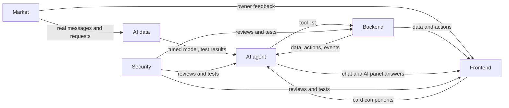

# Term 1 Plan

> **Goal:** at the first presentation, right after week 14 (end of December 2026),
> we show the idea, a first working version online, and proof that real shops
> want it: an AI manager, running on **our own tuned model**, that manages a
> coffee shop's customer chats, orders, stock and cash, on top of our ERP and CRM.
>
> Week numbers are the term's weeks. The plan runs from **week 4** (starting
> October 10) to **week 14**. **Week 10** is a practice presentation.
>
> This plan says **what** each subteam delivers, not **how**. Each subteam picks
> its own tools and can change them, as long as the agreements still hold.
> The full design is in [technical-structure.md](technical-structure.md).

## Contents

1. [Final output of term 1](#1-final-output-of-term-1)
2. [Subteams](#2-subteams)
3. [How the subteams connect](#3-how-the-subteams-connect)
4. [Timeline at a glance](#4-timeline-at-a-glance)
5. [Build: weeks 4 to 9](#5-build-weeks-4-to-9)
6. [Practice presentation: week 10](#6-practice-presentation-week-10)
7. [From practice to the real presentation: weeks 11 to 14](#7-from-practice-to-the-real-presentation-weeks-11-to-14)

---

## 1. Final output of term 1

A first version of the full idea, not the full product. Everything not listed
here is ordered into term 2, not dropped.

### 1.1 The working system (online, usable live)

| Part | What works |
|------|-----------|
| AI manager | Runs on our tuned model. Answers customers, takes orders, tells the owner what needs attention, acts alone on normal work and asks approval for risky actions |
| Customer chats | Website chat and Telegram (WhatsApp if Meta approves in time). The AI handles the chat; staff can take over |
| Menu and recipes | Items with sizes and options, recipes made of ingredients, cost per item |
| Stock | Ingredients and products go down with every sale; waste logged by tap or by telling the AI; draft purchase orders when stock runs low |
| Sales and orders | A fast counter sales screen, plus pickup and delivery orders from chats and the website, in one order flow |
| Shifts and cash | Open and close a shift, counted cash against expected, gaps flagged |
| Customers | Known by phone, history, usual order, loyalty points, notes |
| Store website | The café's menu, ordering, and a chat window answered by the AI |
| Home | A to-do list from the AI (morning briefing) and key numbers |
| Team | Owner invites staff; each role sees and does only what it allows, in screens and in the AI |
| Two templates | Coffee shop (the showcase) and small market (to prove the engine adapts) |

### 1.2 The live demo

1. A committee member messages the café from their own phone: *"عايز ٢ لاتيه وكرواسون تيك أواي"*
2. The AI answers, confirms the order and a ready time. The order appears on the sales screen; ingredients go down
3. They send a complaint. The AI hands it to staff instead of guessing
4. The owner asks: *"بعت كام النهارده، والاتيه بيكلفني كام دلوقتي؟"*. The AI answers with real numbers as cards
5. The morning briefing: milk runs out tomorrow (draft purchase order waiting for approval), a cash gap from yesterday's shift
6. Switch the business to the small market template: the same AI answers *"عندك لبن جهينة؟"* correctly

### 1.3 Proof from the real market

| Target | By practice (week 10) | By the real presentation |
|--------|:---------------------:|:------------------------:|
| Interviews with coffee shop and small market owners | 30 | 30+ |
| Sign-ups on the waiting list | 30 | 50 |
| Shops that agree in writing to try the system | 2 | 5 |
| Pilot shops using the system for real | - | 2 to 3, with feedback and numbers |
| Real quotes about their problems | Yes | Yes, plus pilot quotes |

### 1.4 AI results

- Our tuned model powering the whole AI, with no ready-made commercial model anywhere
- A test set of 150+ requests (coffee shop, small market, Arabic, Franco, English)
- Tuned versus untuned base model on the same test set
- Two base models compared (a tool-strong model and an Egyptian-dialect model)
- Adaptation: score on the small market category
- Pilot numbers: share of chats handled with no human, orders captured from chat, reply time

### 1.5 Security

- A test proving one business cannot see another's data
- Roles enforced in screens and in the AI (staff cannot see profit)
- Every change recorded, including every AI action
- The AI tested against tricks in customer messages (prompt injection)

### 1.6 The slides

One slide per subteam: problem, market proof, solution, architecture, AI and
model results, security, live demo, and the term 2 roadmap.

---

## 2. Subteams

| Subteam | People | Owns |
|---------|:------:|------|
| Backend | 2 CS | Core, ERP, CRM, Channels: the data, the rules, the events, the online version |
| Frontend | 2 CS | Sales screen, dashboard, inbox, store website, landing page |
| AI agent | 2 AI | The AI manager: customer agent, owner partner, proactive jobs, tools, approvals |
| AI data | 2 AI | Our model: base model choice, training data, fine-tuning, serving, test set |
| Market | 1 AI (lead) + everyone | Interviews, sign-ups, pilot shops, real messages for training |
| Security | 1 | Login, roles, walls between businesses, audit, AI safety |

- Each subteam has **one lead**; one person has the final say on scope
- Everyone visits **at least 3 shops** during weeks 5 to 8

---

## 3. How the subteams connect

### 3.1 Working rules

| # | Rule | What it means |
|:-:|------|---------------|
| 1 | Agreement first | Before a feature is built, the subteams write down what Backend provides, what Frontend shows, which AI tools use it and which roles may use it. Kept in `contracts.md` |
| 2 | Nobody waits | Frontend and AI build against fake data that matches the agreement, then switch to the real parts on integration day |
| 3 | Integration day every week | On the last working day, the real parts are connected and the week's demo runs from start to end |
| 4 | Definition of done | It works in the weekly demo and Security has reviewed it |
| 5 | Changing an agreement | Every subteam it touches must say yes |
| 6 | Leads meeting | Once a week, 30 minutes: delivered, blocked, next week |

### 3.2 Handoffs

| From | To | What | When |
|------|----|------|------|
| AI agent | Backend | AI tool list: what each tool does, needs and returns | Week 4 |
| Security | Everyone | Roles and what each may do, including AI actions | Week 4 |
| Frontend | Everyone | Wireframes of every term 1 screen | Week 4 |
| AI data | AI agent | The untuned base model running and reachable | Week 5 |
| Backend | Frontend, AI agent | Each feature's data, actions and events, ready to connect | Every week, by integration day |
| Frontend | AI agent | Order, item, customer and stock cards for AI answers | Week 7 |
| AI data | AI agent | First tuned model ready to plug in | Week 8, updated weeks 9, 11, 12 |
| AI data | AI agent | Test results and weak spots | Every week from week 6 |
| Market | AI data | Real requests and messages from visits and pilots | Every week from week 5 |
| Market | Frontend | What owners liked and found hard | Weeks 6 to 13 |

---

## 4. Timeline at a glance

| Week | Dates | Focus | End-of-week demo |
|:----:|-------|-------|------------------|
| 4 | Oct 10 to 16 | Agreements and foundations | All leads sign off the first `contracts.md` |
| 5 | Oct 17 to 23 | Accounts, business setup, base model running | Owner signs up as a coffee shop, invites staff; the base model answers through one fake tool |
| 6 | Oct 24 to 30 | Menu, recipes, stock | An item added on screen and one by talking to the AI; waste logged; stock goes down |
| 7 | Oct 31 to Nov 6 | Sales screen, orders, shifts | A counter sale deducts ingredients; a shift closes with a cash gap flagged |
| 8 | Nov 7 to 13 | Chats, customers, store website | A customer orders by chat and on the website; the AI takes it; the customer is saved with loyalty |
| 9 | Nov 14 to 20 | AI manager, home, online | Morning briefing, low-stock purchase draft with approval; full demo on the online system, twice |
| 10 | Nov 21 to 27 | **Practice presentation** | Feedback collected |
| 11 | Nov 28 to Dec 4 | Fix feedback, pilots start, small market template | Pilot cafés using the system |
| 12 | Dec 5 to 11 | Pilot use, final tuning, adaptation test | Fixes from pilot feedback live |
| 13 | Dec 12 to 18 | Final results, freeze | Final numbers ready, no new features |
| 14 | Dec 19 to 25 | Rehearsals | Two full rehearsals |
| - | After week 14 | **First presentation** | |

---

## 5. Build: weeks 4 to 9

### Week 4 (Oct 10 to 16): Agreements and foundations

| Subteam | Delivers |
|---------|----------|
| Backend | Shared place where everyone's work runs together. The list of records the system stores (business, member, role, template, item, variant, modifier, ingredient, recipe, stock movement, order, payment, shift, supplier, purchase, customer, loyalty, conversation, message). Order stages and their rules |
| Frontend | Wireframes of all term 1 screens: sales screen, orders, menu and stock, shift close, customers, inbox, AI panel, approvals, home, settings, store website. Landing page design |
| AI agent | The AI tool list. The rules for what the AI does alone and what needs approval. 3 full example conversations (customer and owner) |
| AI data | Shortlist of open base models. Format of one training example. List of open datasets to use. 30 example requests (coffee shop) |
| Security | Roles and permissions, including AI actions. Main risks |
| Market | Interview script, list of 50 coffee shops and small markets, sign-up form. Start the WhatsApp business request; create the Telegram bot |

**Integration:** all leads sign off the first `contracts.md`.

### Week 5 (Oct 17 to 23): Accounts, business setup, base model running

| Subteam | Delivers |
|---------|----------|
| Backend | Sign up, log in, create a business from a template (coffee shop), invite members with roles, audit log, events with outbox |
| Frontend | Sign up and login, app frame with menu, language switch, AI panel. Landing page live |
| AI agent | The AI engine answering in the panel, calling fake tools |
| AI data | Untuned base model running on a rented GPU, reachable by AI agent. Test set v0 (50 requests). Training data v0 (200 examples). GPU budget |
| Security | Login protection, roles enforced, one business cannot see another's data |
| Market | 10 interviews. Share the landing page |

**Integration demo:** an owner signs up as a coffee shop and invites a barista who sees only what the role allows; the base model answers in the AI panel through a fake tool.

### Week 6 (Oct 24 to 30): Menu, recipes, stock

| Subteam | Delivers |
|---------|----------|
| Backend | Items, sizes and options, categories, ingredients, recipes, cost per item. Stock movements (in, waste, adjust) and levels. Suppliers |
| Frontend | Menu screens, recipe editor, ingredient and stock screens, waste log |
| AI agent | Real tools: search menu, check stock, item cost, add an item by talking, log waste by talking |
| AI data | First small tuning run to prove the pipeline. Compare the base models on the test set |
| Security | Review menu and stock, limits against abuse |
| Market | 10 interviews. Pass real phrases to AI data |

**Integration demo:** an item added on screen and one by telling the AI; waste logged by message; stock levels change in both.

### Week 7 (Oct 31 to Nov 6): Sales screen, orders, shifts

| Subteam | Delivers |
|---------|----------|
| Backend | Counter sales, orders with stages (pickup, delivery), payments, order numbers per business, sales deduct recipe ingredients. Shifts with cash count. Draft purchase orders |
| Frontend | Fast counter sales screen, open orders board, shift open and close. Cards ready for the AI |
| AI agent | Create and update orders, record a sale, sales numbers, cash status. Answers as the app's cards |
| AI data | Training data v1 (1,000 examples, including real ones). Second tuning run. Test set v1 (100 requests) |
| Security | Who can give discounts, cancel orders, see profit and cash. Review |
| Market | 10 interviews (30 total). Aim for 20 sign-ups |

**Integration demo:** a counter sale lowers milk and beans; a shift closes with a cash gap flagged; the owner asks the AI for today's sales.

### Week 8 (Nov 7 to 13): Chats, customers, store website

| Subteam | Delivers |
|---------|----------|
| Backend | Channels: website chat and Telegram, conversations, messages, handoff. Customers by phone, timeline, usual order, loyalty. Public store website data (menu, place an order) |
| Frontend | Inbox with take-over, customer page, store website (menu, ordering, chat window) |
| AI agent | Customer agent: answers menu questions, takes orders, confirms ready time, recognizes regulars, hands off on complaints |
| AI data | First tuned model ready; tested against the untuned model. Arabic and Franco quality pass |
| Security | Protect the public website and chats from spam and fake orders. Prompt injection tests on the customer agent |
| Market | Show the working system to interviewed shops. Ask for pilot commitments |

**Integration demo:** a customer orders on Telegram and another on the website; the AI takes both; they appear on the orders board; the customer gets loyalty points.

### Week 9 (Nov 14 to 20): AI manager, home, online

| Subteam | Delivers |
|---------|----------|
| Backend | Events for low stock, cash gaps and cost changes. Approvals. Home numbers. Demo data. System online |
| Frontend | Home as a to-do list, approvals screen, mobile pass, consistent look |
| AI agent | Morning briefing, alerts, draft purchase order when stock runs low, price suggestion when cost changes, approval flow. Runs on the tuned model |
| AI data | Tuned model update. First results recorded (tuned versus untuned, two base models) |
| Security | Full run of all security tests. Fixes |
| Market | Practice results collected (30 interviews, 30 sign-ups, 2 commitments) |

**Integration demo:** the full demo on the online system, twice, with a bug list sorted by priority.

---

## 6. Practice presentation: week 10

### Week 10 (Nov 21 to 27)

| Subteam | Delivers |
|---------|----------|
| Everyone | No new features, only fixes. Demo script. 1 rehearsal before the practice |
| Market | Market proof slide |
| AI agent and AI data | AI and model results slide |
| Security | Security slide |
| Backend | Architecture slide |
| Frontend | Live demo |
| Leads | Every piece of feedback written down, sorted into "fix before the real presentation" and "term 2" |

---

## 7. From practice to the real presentation: weeks 11 to 14

### Week 11 (Nov 28 to Dec 4): Fix feedback, pilots start, small market template

| Subteam | Delivers |
|---------|----------|
| Backend | Fixes from the feedback. Small market template (barcodes, credit accounts basic, expiry dates basic). Pilot accounts ready. WhatsApp connected if approved |
| Frontend | Fixes from the feedback. Screens follow the small market template |
| AI agent | Fixes from the feedback. AI follows the small market template's tools and rules |
| AI data | Third tuning run with practice feedback. Small market test set (50 requests) for the adaptation test |
| Security | The online system safe for real shops' data |
| Market | 2 to 3 pilot cafés set up and trained. Baseline week numbers before the AI is switched on |

### Week 12 (Dec 5 to 11): Pilot use, final tuning, adaptation test

| Subteam | Delivers |
|---------|----------|
| Backend and Frontend | Fix what pilot shops find hard or broken; sales screen speed at rush hour |
| AI agent | Improve the AI on the pilots' real chats and requests |
| AI data | Pilot requests added (training data 2,000+, test set 150+). Final tuning run. Adaptation test on the small market |
| Security | Watch the pilot for problems; fix what is found |
| Market | Pilot feedback, quotes and numbers. Push toward 50 sign-ups and 5 commitments |

### Week 13 (Dec 12 to 18): Final results, freeze

| Subteam | Delivers |
|---------|----------|
| Everyone | Feature freeze at the end of the week |
| AI data | Final model numbers: tuned versus untuned, two base models, adaptation |
| AI agent | Final pilot AI numbers: chats with no human, orders captured, reply time |
| Market | Final market numbers and pilot results |
| Security | Final security test run |
| All subteams | Final version of their slide |

### Week 14 (Dec 19 to 25): Rehearsals

| Subteam | Delivers |
|---------|----------|
| Everyone | Two full rehearsals of slides and live demo. Backup demo video in case the live demo fails |
| Leads | Term 2 roadmap slide: everything ordered into term 2 |

**After week 14: the first presentation.**
