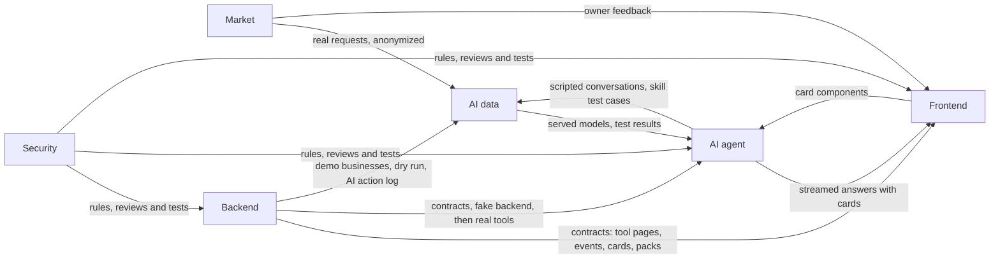

# Term 1 Plan

> **What this file is:** a reference for what each subteam delivers in term 1,
> and roughly when, so the parts arrive in an order that works. It is **not** a
> list of deadlines. The weeks show the order and the pace; something that lands
> a week early or late is fine as long as the order holds and the weekly
> integration demo keeps running. The only fixed dates are the practice
> presentation (week 10) and the first presentation (after week 14).
>
> **Goal:** at the first presentation (end of December 2026) we show the idea, a
> first working version online, and proof that real shops want it: one AI for a
> small business, running on **our own tuned models**, that talks to a coffee
> shop's customers, takes their orders, watches stock and cash, and tells the
> owner what needs attention, all through the tools of our own ERP and CRM.
>
> This plan says **what** each subteam delivers, not **how**. What the system is
> lives in [technical-structure.md](technical-structure.md), and where the code
> goes lives in [project-structure.md](project-structure.md). When this plan and
> the design disagree, the design wins and this plan is updated. Numbers in
> parentheses, like (7.3), are sections of `technical-structure.md`.
>
> Updated 2026-10-19 to follow the rewritten technical structure: a chat-first
> app, tools as the only door, skills, packs, and two model tiers.

## Contents

1. [Final output of term 1](#1-final-output-of-term-1)
2. [Term 1 in the design's words](#2-term-1-in-the-designs-words)
3. [Subteams](#3-subteams)
4. [How the subteams connect](#4-how-the-subteams-connect)
5. [Timeline at a glance](#5-timeline-at-a-glance)
6. [Build: weeks 4 to 9](#6-build-weeks-4-to-9)
7. [Practice presentation: week 10](#7-practice-presentation-week-10)
8. [From practice to the real presentation: weeks 11 to 14](#8-from-practice-to-the-real-presentation-weeks-11-to-14)

---

## 1. Final output of term 1

A first version of the full idea, not the full product. Everything not listed
here is ordered into term 2 (23), not dropped.

### 1.1 The working system (online, usable live)

| Part | What works |
|------|-----------|
| AI | Two faces on our tuned models: the customer agent (small tier) and the owner partner (big tier) (6.1, 6.2). It acts only through tools, follows the core skills, plans multi-step work with one approval per plan, and follows the owner's settings for what it may do alone (6.6) |
| Home: AI chat | The owner opens a chat, not a dashboard. The morning briefing as cards with buttons; answers streamed as text and cards; threads; a side panel for opened cards; **Ask first / Act alone** (17.1) |
| Customer chats | Website chat and Telegram (WhatsApp if Meta approves in time). The AI answers and takes orders; staff take over and hand back in the Inbox |
| Menu and recipes | Items with sizes and options, recipes made of ingredients, cost and margin per item |
| Stock | A ledger of movements: sales deduct recipe ingredients; waste logged by tap or by telling the AI; counts; a forecast; draft purchase orders when stock runs low |
| Sales and orders | A fast sales screen for counter sales, plus pickup, delivery and dine-in orders from chats and the shop page, in one order flow with the template's stages (8.2) |
| Shifts and cash | Open and close a shift, counted cash against expected, gaps flagged |
| Customers | One customer across every channel (2.5): history, usual order, loyalty points, notes, support cases, basic bookings |
| Shop page | The menu and the AI chat on one page, ordering, and an order status page sent as a link |
| Members and roles | The owner invites staff; each role sees and does only what it allows, in screens and in the AI alike |
| Essentials and packs | Every business gets the essentials; the owner turns term 1 packs on and off from Settings or by asking the AI (7.3) |
| Skills | The term 1 core skills (section 2.3 below). The owner changes a skill by talking, with a test run before it is saved (basic) |
| Two templates | Coffee shop (the showcase) and small market (to prove the engine adapts) |

### 1.2 The live demo

1. A committee member messages the café on Telegram from their own phone:
   *"عايز ٢ لاتيه وكرواسون تيك أواي"*
2. The customer agent answers with an order card: the lines, the total and a
   ready time. They confirm; the order appears on the Orders board and the
   ingredients are reserved. The barista marks it ready, and the customer is told
3. They complain that the latte was cold. The AI opens a support case and offers
   a voucher within the owner's limit; when they ask for more than the rules
   allow, it hands the chat to staff instead of guessing
4. The owner asks in the Home chat:
   *"بعت كام النهارده، واللاتيه بيكلفني كام دلوقتي؟"*. The AI answers with real
   numbers, as a sales card and a cost card
5. The morning briefing: milk runs out tomorrow (a draft purchase order on an
   approval card), and a cash gap from yesterday's shift. The owner approves
6. The owner changes a skill by talking:
   *"خلّي عجز الخزنة أول حاجة في تقرير الصبح"* (put the cash gap first in the
   morning briefing). The AI shows the change and a test run, and saves it when
   the owner confirms
7. The demo small market, on the small market template: the same AI answers
   *"عندك لبن جهينة؟"* correctly

### 1.3 Proof from the real market

| Target | By practice (week 10) | By the real presentation |
|--------|:---------------------:|:------------------------:|
| Interviews with coffee shop and small market owners | 30 | 30+ |
| Sign-ups (accounts made from the landing page) | 30 | 50 |
| Shops that agree in writing to try the system | 2 | 5 |
| Pilot shops using the system for real | - | 2 to 3, with feedback and numbers |
| Real quotes about their problems | Yes | Yes, plus pilot quotes |

### 1.4 AI results

These answer the research questions (24).

- Our tuned models powering every AI answer, on both tiers. The model picker
  with other models, and the comparison with commercial ones, are term 2 (6.2);
  commercial models never make training data (6.10)
- A test set of 150+ requests (coffee shop, small market, Egyptian Arabic,
  Franco, English), plus test cases for every term 1 core and template skill (5.5)
- Tuned versus untuned base model on the same test set, per tier
- Two base model families compared (a tool-strong one and an Egyptian-dialect
  one), per tier
- Adaptation: the score on the small market, whose test cases stay out of training
- Skill runs: the share finished correctly. If time allows, the score on skills
  written after training
- Pilot numbers: share of chats handled with no human, orders captured from
  chat, reply time (median and 90th percentile, per tier)

### 1.5 Security

- A test proving business A cannot read business B's data, and a test that each
  module's database user sees only its own schema; the AI layer's user sees none
- Roles checked on every tool, for the app and the AI alike (staff never see
  cost or profit)
- Every write in the audit log, including every AI action (`actor_type = ai`)
- The AI can never raise its own permissions, and skills cannot change
  permissions or approvals
- The customer agent tested against tricks in customer messages (prompt injection)
- Limits against spam and fake orders on the public doors (shop page, chat
  widget, webhooks)
- Personal data masked in logs and training data; no secrets in any repo

### 1.6 The slides

One slide per subteam: problem, market proof, solution, architecture (the four
layers and the modules), AI and model results, security, live demo, and the
term 2 roadmap.

---

## 2. Term 1 in the design's words

What the design puts in term 1 (23), in its own terms, so every subteam builds
against the same list.

### 2.1 Modules and packs

| Module | Term 1 |
|--------|--------|
| Core | Essentials: businesses, members and roles, locations, audit, notifications, templates, packs on and off |
| ERP | Catalog (essentials). Packs: `orders`, `options`, `delivery`, `tables`, `sales_screen`, `shifts_cash`, `stock`, `recipes`, `purchasing`, `expenses`, `barcodes`; `expiry` and `credit` basic |
| CRM | Customers, identities, timeline, notes, tags, follow-ups (essentials). Packs: `loyalty`, `support`, `bookings` basic |
| Channels | Website chat and the Inbox (essentials). Packs: `telegram`; `whatsapp` if Meta approves |
| Store | The shop page (essentials). Pack: `website` basic (banner, menu display, order status) |
| Reports | Home numbers, sales, profit |
| Studio | The brand kit, only if time allows |
| AI layer | Both faces, jobs, the planner, approvals, permission settings, the business brain (profile, knowledge, memory, threads), core skills, basic skill edits |

Term 2 packs: `branches`, `online_payments`, `couriers`, `offline_sales`,
`e_invoicing`, `segments_consent`, `instagram_facebook`, `search_presence`,
`studio`, `marketing`, `team`, and the full versions of the basic ones.

### 2.2 Windows

Windows 1 to 9 and 13 to 15 (17.2): sign up and setup, Home, Sales screen,
Orders, Menu and stock, Customers, Inbox, Approvals, Settings, Shop page, Order
status, Landing page.

In term 1, a few things inside these windows wait for term 2 tools: the menu
photo in setup and invoice photos need image reading, and voice notes need
speech to text (4.5). Term 1 does them by typing.

### 2.3 Core skills

The term 1 skills from the catalog (16):

| Who runs it | Skills |
|-------------|--------|
| Customer agent | `answer_customer`, `take_order`, `order_request` (when `orders` is off), `handle_complaint`, `book_table` (basic) |
| Owner partner | `add_item_by_talking`, `log_waste_by_talking`, `staff_how_to`, `price_review`, `receive_delivery` (by text), `website_update` |
| Jobs | `morning_briefing`, `reorder_low_stock`, `cash_gap_alert`, `cost_change_alert`, `end_of_day`, `prepare_tomorrow`, `new_regular` |
| Small market template | `debt_reminders` (basic) |

`end_of_day` and `prepare_tomorrow` use Team tools, which come in term 2. In
term 1 those steps are skipped because the `team` pack is off (7.3, rule 4).

### 2.4 Tools

Every tool in sections 6.9, 7.5, 8.5, 9.5, 10.2, 11.4 and 15.1 whose pack is in
term 1 and that is not marked T2. Each one gets its full reference page (4.4)
before it is built.

---

## 3. Subteams

| Subteam | People | Owns | Works in |
|---------|:------:|------|----------|
| Backend | 2 CS | The Core, ERP, CRM, Channels, Store and Reports modules; the platform (tenancy, permissions, packs, tool registry, events, scheduler, undo, dry run); the four doors; the tool reference pages; the fake backend; the online version | `app-backend` |
| Frontend | 2 CS | The chat-first app (windows 1 to 9), the shop page and order status (13, 14), the landing page (15), the shared cards | `app-web` |
| AI agent | 2 AI | The AI layer: both faces, jobs, the planner, approvals, permission settings, the business brain, core and template skills, tool loading and `ai.find_tools` | `app-ai-agent` |
| AI data | 2 AI | The models: base model choice per tier, training data, fine-tuning, serving, the test set, results | `app-ai-model` |
| Market | 1 AI (lead) + everyone | Interviews, sign-ups, pilot shops, real messages for training (with consent) | |
| Security | 1 | Login, roles and permissions, the wall between businesses, audit, AI safety. Decides the rules, then reviews and tests every part | All three repos (reviews) |

- Each subteam has **one lead**; one person has the final say on scope
- Everyone visits **at least 3 shops** during weeks 5 to 8
- The contracts are shared. Backend writes and keeps them; each subteam that
  depends on a contract reviews it: the tool descriptions (AI agent, because the
  model reads them), the cards (Frontend), the training format (AI agent and AI
  data), the roles and the AI defaults (Security and AI agent)

### 3.1 Backend: two tracks

The backend has two sides (2.9 in the design): the platform and the business
systems. Each backend member takes one track; they meet at the tool pages.

| Week | Platform track | Business systems track |
|:----:|----------------|------------------------|
| 5 | Done: accounts, log-in, sessions and devices, business setup, the wall between businesses, audit, outbox. Next: roles and permissions, packs and templates, the tool registry, inviting members | The demo coffee shop data, the fake backend, shared pieces (money, per-business numbers, retry keys) |
| 6 | The AI door (service token, who the AI acts for), Home routes | Catalog, recipes and cost, the stock ledger and levels, suppliers |
| 7 | Streaming relay to the app, realtime for the Orders board | Orders, counter sales, shifts and cash, purchases, expenses, Reports first version |
| 8 | The public door and its limits | Channels (website chat, Telegram), CRM (customers, identities, loyalty, cases, bookings), Store (shop page, order status) |
| 9 | Scheduler, approvals, undo, dry run, the AI action log | Low stock, cash gap and cost change events, demo data, home numbers |

---

## 4. How the subteams connect

### 4.1 Working rules

| # | Rule | What it means |
|:-:|------|---------------|
| 1 | Contract first | Before a tool is built, its reference page is written in `app-backend/contracts` (purpose, inputs, output, errors, effects, rules, examples, version). The same goes for events, cards and packs. Everyone builds against the page (4.4) |
| 2 | Nobody waits | Frontend and the AI team build against the fake backend, which answers every tool from its page's examples and the demo businesses, then switch to the real tools when they are ready |
| 3 | Integration day every week | On the last working day, the real parts are connected and the week's demo runs from start to end |
| 4 | Definition of done | It works in the weekly demo, it matches its reference page (the pages test passes), and Security has reviewed it |
| 5 | Changing a contract | Announced to every subteam before it is merged, and written in `contracts/changes`. A breaking change is a new version; the old one keeps working (4.4) |
| 6 | Design first | A change to what the system is goes into `technical-structure.md` first (and `project-structure.md` if it moves folders), then into this plan |
| 7 | Leads meeting | Once a week, 30 minutes: delivered, blocked, next |

### 4.2 Handoffs

The order matters more than the week.

| From | To | What | Around |
|------|----|------|--------|
| Backend | Everyone | The `rules/` pages and the contracts skeleton: values (IDs, statuses, roles, channels), the event envelope, error codes, limits | Week 4 |
| Backend and AI agent | Everyone | The term 1 tool list (name, one line, pack, face, read or write) and the packs list | Week 4 |
| Security | Everyone | Roles and permissions, including every AI area; the login decision (26) | Week 4 |
| AI agent and Security | Everyone | Default AI permission settings (6.6) and hand-off rules | Week 4 |
| Frontend | Everyone | Wireframes of the term 1 windows and the card list | Week 4 |
| AI data and AI agent | Everyone | The training example format, in `contracts/training` | Week 4 |
| Backend | Frontend, AI agent, AI data | The fake backend and the demo coffee shop, growing with every new tool page | From week 5 |
| AI data | AI agent | The untuned base models for both tiers, served with the chat-completions-with-tools API and streaming | Week 5 |
| Backend | Frontend, AI agent | Each feature's tool pages, a week before its real tools | Every week |
| Backend | Frontend, AI agent | Each feature's real tools, events and the streaming relay, ready to connect | Every week, by integration day |
| AI agent | AI data | Scripted conversations and skill test cases | Every week from week 5 |
| AI data | AI agent | Test results and weak spots | Every week from week 6 |
| Frontend | AI agent | Order, item, stock, customer, cash and sales cards for AI answers | Week 7; approval and plan cards week 9 |
| AI data | AI agent | First tuned models, ready to plug in | Week 8, updated weeks 9, 11, 12 |
| Backend | AI agent, AI data | Dry-run mode and the AI action log | Week 9 |
| Market | AI data | Real requests and messages from visits and pilots, anonymized, with consent | Every week from week 5 |
| Market | Frontend | What owners liked and found hard | Weeks 6 to 13 |

---

## 5. Timeline at a glance

Week numbers are the term's weeks. They are targets for the order of the work,
not deadlines.

| Week | Dates | Focus | End-of-week demo |
|:----:|-------|-------|------------------|
| 4 | Oct 10 to 16 | Agreements | All leads agree the first contracts |
| 5 | Oct 17 to 23 | Accounts, business setup, packs, base models running | An owner signs up as a coffee shop and invites staff; the base model answers in the Home chat through the fake backend |
| 6 | Oct 24 to 30 | Menu, recipes, stock | An item added on screen and one by talking to the AI; waste logged; stock goes down |
| 7 | Oct 31 to Nov 6 | Sales screen, orders, shifts | A counter sale deducts ingredients; a shift closes with a cash gap flagged |
| 8 | Nov 7 to 13 | Chats, customers, shop page | Customers order by Telegram and on the shop page; the AI takes both; a complaint becomes a case |
| 9 | Nov 14 to 20 | AI manager, home, online | Morning briefing, low-stock purchase draft with approval, a skill edited by talking; full demo online, twice |
| 10 | Nov 21 to 27 | **Practice presentation** | Feedback collected |
| 11 | Nov 28 to Dec 4 | Fix feedback, pilots start, small market template | Pilot cafés using the system |
| 12 | Dec 5 to 11 | Pilot use, final tuning, adaptation test | Fixes from pilot feedback live |
| 13 | Dec 12 to 18 | Final results, freeze | Final numbers ready, no new features |
| 14 | Dec 19 to 25 | Rehearsals | Two full rehearsals |
| - | After week 14 | **First presentation** | |

---

## 6. Build: weeks 4 to 9

### Week 4 (Oct 10 to 16): Agreements

| Subteam | Delivers |
|---------|----------|
| Backend | The `rules/` pages (modules, data, tools, events, web, contracts). The contracts skeleton: values (ID types, order statuses, roles and permissions, channels, payment methods, AI permission settings), the event envelope and the term 1 events list, error codes, limits. With the AI agent, the term 1 tool list. The term 1 packs list with what each needs. The three repos set up so any member can run them |
| Frontend | Wireframes of windows 1 to 9 and 13 to 15: the sidebar by role and packs, the Home chat with briefing cards and the side panel, the **+** menu, Ask first / Act alone, the sales screen. Arabic right to left, and a mobile sketch of the key windows. The card list (order, item, stock, customer, cash, sales, approval, plan). Landing page design and text |
| AI agent | With Backend, the term 1 tool list. The default AI permission settings (6.6) and the hand-off rules. The term 1 core skills, each with the packs and tools it needs. 3 full example conversations written as tool calls: a customer orders on chat, the owner asks for sales and a latte's cost, low stock becomes a purchase draft for approval |
| AI data | Shortlist of open base models per tier: a tool-strong family and an Egyptian-dialect family. For each: size, Arabic quality, tool use, license, GPU needed. The training example format. Open datasets with their licenses. 30 example requests (coffee shop) with the right tool or skill. How we score: right tool, right inputs, right final answer, hand-off when it should, skill run finished. GPU plan |
| Security | Roles and permissions (owner, manager, staff, viewer) for every term 1 tool area and AI area. Main risks, each with how we stop it. GitHub rules: no secrets, changes to `main` only through a pull request with one review. Login: sessions with lock-out, or tokens (26) |
| Market | Interview script, list of 50 coffee shops and small markets, sign-up form, consent text for training on anonymized messages. Start the WhatsApp business request; create the Telegram bot |

**Integration:** all leads agree the first contracts. Every window shows data a
tool returns; every skill uses tools on the list; every tool has a role rule and
an AI default; every example request maps to a tool or a skill; the events list
covers every job; open questions are written down, each with an owner.

### Week 5 (Oct 17 to 23): Accounts, business setup, packs, base models running

| Subteam | Delivers |
|---------|----------|
| Backend | Platform: tenancy with row-level security, auth, permissions, context, audit, events with the outbox, packs. Core: sign up, a business from the coffee shop template (its packs turned on), members invited with roles, packs on and off. The tool registry, filtering by pack, role and face. Reference pages for the Core and catalog tools. The fake backend with the demo coffee shop |
| Frontend | Sign up and setup (window 1). The app frame: sidebar by role and packs, language switch. The Home chat with streaming, against the fake backend. Landing page live |
| AI agent | The owner partner answering in the Home chat through the fake backend: skills loaded with only their tools, every tool filtered for the person. `ai.find_tools` |
| AI data | Untuned base models for both tiers on a rented GPU, reachable by the AI agent. Test set v0 (50 requests). Training data v0 (200 examples). GPU budget |
| Security | Login protection. The isolation test (business A reads business B: must fail). The schema users test. The roles test started |
| Market | 10 interviews. Share the landing page |

**Integration demo:** an owner signs up as a coffee shop and the template turns
on its packs; they invite a barista whose sidebar shows only what the role
allows; the owner asks the AI about the business and the base model answers
through `core.get_business` on the fake backend.

### Week 6 (Oct 24 to 30): Menu, recipes, stock

| Subteam | Delivers |
|---------|----------|
| Backend | Catalog: items, sizes, options, categories. Recipes and cost per item. The stock ledger and levels (in, waste, adjust, count) and the forecast. Suppliers. Each tool's page first. Tests: pages, tools, and rebuilding stock levels from the ledger |
| Frontend | Menu and stock (window 5): items, sizes and options, recipe editor, ingredients, stock levels, waste log, suppliers. Item and stock cards |
| AI agent | Skills: `add_item_by_talking`, `log_waste_by_talking`, `staff_how_to`. The owner asks about stock and item cost on the real tools |
| AI data | First small tuning run, to prove the pipeline. Compare the base models on the test set |
| Security | Review catalog and stock. Limits on inputs and uploads. Staff never see cost |
| Market | 10 interviews. Pass real phrases to AI data |

**Integration demo:** an item added on screen and one by telling the AI; waste
logged by message; stock levels change in both; a barista asks how to make a
Spanish latte and gets the recipe without its cost.

### Week 7 (Oct 31 to Nov 6): Sales screen, orders, shifts

| Subteam | Delivers |
|---------|----------|
| Backend | Orders with the template's stages, all moves in one place (8.2); order numbers per business; line snapshots; payments. Counter sales, created and completed in one step. Stock reserved on accept, deducted on completion. Shifts and cash, with `CashGapFound`. Draft purchase orders. Expenses. Retry keys. Reports: sales, profit, home numbers (first version). Tests: order flow, retried calls write once |
| Frontend | The sales screen (window 3): big buttons, cart, payment, shift open and close with the cash count. The Orders board (window 4), live. Order, cash and sales cards for AI answers |
| AI agent | Orders through tools (create, move to the next stage). Sales and cash questions answered as cards. The Ask first / Act alone switch wired to the settings |
| AI data | Training data v1 (1,000 examples, including real ones). Second tuning run. Test set v1 (100 requests) |
| Security | Who can give discounts, cancel, refund, and see profit and cash. Review |
| Market | 10 interviews (30 total). Aim for 20 sign-ups |

**Integration demo:** a counter sale lowers milk and beans; a shift closes with
a cash gap flagged; the owner asks the AI for today's sales and gets a sales card.

### Week 8 (Nov 7 to 13): Chats, customers, shop page

| Subteam | Delivers |
|---------|----------|
| Backend | Channels: website chat and Telegram adapters, the incoming queue with duplicates dropped, conversations, messages, hand-off and hand back, auto-replies. CRM: identity resolution (phones to +20), customers, the timeline from events, stats and usual order, loyalty, notes, tags, follow-ups, support cases and vouchers, basic bookings. Store: shop page data, public ordering, order status. The public door with rate limits. Tests: the cross-module processes (2.7) end to end |
| Frontend | Inbox (window 7) with take over and hand back. Customers (window 6): customer page, cases, bookings. Shop page (window 13) with the menu and the chat. Order status (window 14). Customer card |
| AI agent | The customer agent on the small tier: `answer_customer`, `take_order`, `handle_complaint`, `book_table` (basic), `order_request`. The `new_regular` job |
| AI data | First tuned models ready, tested against the untuned ones. Arabic and Franco quality pass |
| Security | The public shop page and chats protected from spam and fake orders. Prompt injection tests on the customer agent. The customer face limited to its own tools |
| Market | Show the working system to interviewed shops. Ask for pilot commitments |

**Integration demo:** a customer orders on Telegram and another on the shop
page; the AI takes both; they appear on the Orders board and both get loyalty
points; a complaint opens a case and reaches staff in the Inbox.

### Week 9 (Nov 14 to 20): AI manager, home, online

| Subteam | Delivers |
|---------|----------|
| Backend | The scheduler (morning briefing, expiring stock). Events for low stock, cash gaps and cost changes. Approvals (26). Undo from the audit log. Dry-run mode. The AI action log, masked. Home numbers. Demo data. The system online |
| Frontend | Home with briefing cards and buttons. Approvals (window 8) with the four buttons (6.6). Settings (window 9): business, members and roles, the library of packs, channels, AI rules, knowledge, skills. Approval and plan cards. Mobile pass, one consistent look |
| AI agent | The planner: plan, one approval per plan, run, check, undo. Jobs: `morning_briefing`, `reorder_low_stock`, `cash_gap_alert`, `cost_change_alert`, `end_of_day`, `prepare_tomorrow`. Skills: `price_review`, `receive_delivery`, `website_update`. The owner edits a skill by talking, with a dry run before it is saved. Threads and memory. Runs on the tuned models |
| AI data | Tuned model update. First results recorded: tuned versus untuned, two base model families, per tier |
| Security | Full run of all security tests, including "the AI cannot raise its own permission". Fixes |
| Market | Practice results collected (30 interviews, 30 sign-ups, 2 commitments) |

**Integration demo:** the full demo (1.2, steps 1 to 6) on the online system,
twice, with a bug list sorted by priority.

---

## 7. Practice presentation: week 10

### Week 10 (Nov 21 to 27)

| Subteam | Delivers |
|---------|----------|
| Everyone | No new features, only fixes. Demo script. 1 rehearsal before the practice |
| Market | Market proof slide |
| AI agent and AI data | AI and model results slide, framed by the research questions (24) |
| Security | Security slide |
| Backend | Architecture slide: the four layers, the modules, tools as the only door |
| Frontend | Live demo |
| Leads | Every piece of feedback written down, sorted into "fix before the real presentation" and "term 2" |

---

## 8. From practice to the real presentation: weeks 11 to 14

### Week 11 (Nov 28 to Dec 4): Fix feedback, pilots start, small market template

| Subteam | Delivers |
|---------|----------|
| Backend | Fixes from the feedback. The small market template: its packs (`barcodes`, `credit` basic, `expiry` basic), fields, stages and home items. The demo small market. Pilot accounts ready. WhatsApp connected if approved |
| Frontend | Fixes from the feedback. Windows follow the small market template (barcodes and credit on the sales screen, debts and expiring items on Home) |
| AI agent | Fixes from the feedback. The small market template's skills (`debt_reminders` basic); the AI follows its packs, tools and rules |
| AI data | Third tuning run with the practice feedback. Small market test set (50 requests) for the adaptation test, kept out of training |
| Security | The online system safe for real shops' data |
| Market | 2 to 3 pilot cafés set up and trained. Baseline week numbers before the AI is switched on |

### Week 12 (Dec 5 to 11): Pilot use, final tuning, adaptation test

| Subteam | Delivers |
|---------|----------|
| Backend and Frontend | Fix what pilot shops find hard or broken; sales screen speed at rush hour |
| AI agent | Improve the AI and the skills on the pilots' real chats and requests |
| AI data | Pilot requests added (training data 2,000+, test set 150+). Final tuning run. Adaptation test on the small market. If time, the score on skills written after training |
| Security | Watch the pilot for problems; fix what is found |
| Market | Pilot feedback, quotes and numbers. Push toward 50 sign-ups and 5 commitments |

### Week 13 (Dec 12 to 18): Final results, freeze

| Subteam | Delivers |
|---------|----------|
| Everyone | Feature freeze at the end of the week |
| AI data | Final model numbers: tuned versus untuned, two base model families, per tier; adaptation |
| AI agent | Final pilot AI numbers: chats with no human, orders captured, skill runs, reply time per tier |
| Market | Final market numbers and pilot results |
| Security | Final security test run |
| All subteams | Final version of their slide |

### Week 14 (Dec 19 to 25): Rehearsals

| Subteam | Delivers |
|---------|----------|
| Everyone | Two full rehearsals of slides and live demo. Backup demo video in case the live demo fails |
| Leads | Term 2 roadmap slide, from section 23: everything ordered into term 2 |

**After week 14: the first presentation.**