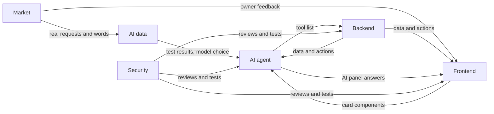

# Term 1 Plan

> **Goal:** at the first presentation, right after week 14 (end of December 2026), we
> show the idea, a first working version online, and proof that real shops want it.
>
> Week numbers are the term's weeks. The plan runs from **week 4** (starting
> October 10) to **week 14**. **Week 10** is a practice presentation to get feedback.
>
> This plan says **what** each subteam delivers, not **how**. Each subteam picks its
> own tools and can change them, as long as the agreements in this plan still hold.

## Contents

1. [Final output of term 1](#1-final-output-of-term-1)
2. [Subteams](#2-subteams)
3. [How the subteams connect](#3-how-the-subteams-connect)
4. [Timeline at a glance](#4-timeline-at-a-glance)
5. [Build: weeks 4 to 9](#5-build-weeks-4-to-9)
6. [Practice presentation: week 10](#6-practice-presentation-week-10)
7. [From practice to the real presentation: weeks 11 to 14](#7-from-practice-to-the-real-presentation-weeks-11-to-14)

---

## 1. Final output of term 1

What we bring to the first presentation. A first version, not the full product.

### 1.1 The working system (online, usable live)

| Part | What works |
|------|-----------|
| Accounts and team | An owner signs up, creates a business and invites members. Each member only sees what their role allows |
| Products and stock | Products with sizes and colors. Stock goes up and down with full history |
| Orders | Online orders with statuses, quick in-store sale, cash on delivery |
| Customers | Each customer's orders, total spend, notes and tasks |
| Store website | A buyer browses products and orders with cash on delivery. The order lands in the dashboard |
| AI helper (Arabic and English) | Adds products, creates orders, finds customers, answers sales questions. Shows a card and waits for the owner to confirm before saving |
| Dashboard | Sales, orders, profit, top products |

### 1.2 The live demo

1. A buyer orders on the store website
2. The order appears in the dashboard and stock goes down
3. The owner tells the AI: *"Mariam ordered 2 black hoodies size L, cash on delivery"*. The AI shows the order card
4. The owner confirms, then asks: *"How much did I sell this week?"*. The AI answers with real numbers

### 1.3 Proof from the real market

| Target | By practice (week 10) | By the real presentation |
|--------|:---------------------:|:------------------------:|
| Interviews with shop owners (physical and online) | 30 | 30+ |
| Sign-ups on the waiting list | 30 | 50 |
| Shops that agree in writing to try the system | 2 | 5 |
| Pilot shops using the system for real | - | 2 to 3, with their feedback |
| Real quotes about their problems | Yes | Yes, plus pilot quotes |

### 1.4 AI results

- A test set of 100+ real requests in Arabic and English
- How often the AI picks the right action, compared across 3 models
- Which model we chose, and why
- How it did with the pilot shops' real requests

### 1.5 Security

- A test proving one business cannot see another's data
- Roles enforced (for example, staff cannot see profit)
- Every change recorded
- The AI tested against tricks (prompt injection)

### 1.6 The slides

One slide per subteam: problem, market proof, solution, architecture, AI results,
security, live demo, and the term 2 roadmap. Nothing is dropped; the roadmap
shows what comes in term 2.

---

## 2. Subteams

| Subteam | People | Owns |
|---------|:------:|------|
| Backend | 2 CS | The data and rules of the system, the online version |
| Frontend | 2 CS | Dashboard screens, store website, landing page |
| AI agent | 2 AI | The AI helper, its tools, its answers as cards |
| AI data | 2 AI | Arabic and English quality, test set, model choice |
| Market | 1 AI (lead) + everyone | Interviews, sign-ups, pilot shops |
| Security | 1 | Login safety, roles, walls between businesses, AI safety |

- Each subteam has **one lead**
- Everyone visits **at least 3 shops** during weeks 5 to 8

---

## 3. How the subteams connect

### 3.1 Working rules

| # | Rule | What it means |
|:-:|------|---------------|
| 1 | Agreement first | Before a feature is built, the subteams write down what Backend provides, what Frontend shows, which AI tools use it and which roles may use it. Kept in `contracts.md` |
| 2 | Nobody waits | Frontend and AI build against fake data that matches the agreement, then switch to the real parts on integration day |
| 3 | Integration day every week | On the last working day, the real parts are connected and the week's demo runs from start to end |
| 4 | Definition of done | It works in the weekly demo and Security has reviewed it |
| 5 | Changing an agreement | Every subteam it touches must say yes |
| 6 | Leads meeting | Once a week, 30 minutes: delivered, blocked, next week |

### 3.2 Handoffs

| From | To | What | When |
|------|----|------|------|
| AI agent | Backend | AI tool list: what each tool does, needs and returns | Week 4 |
| Security | Everyone | Roles and what each may do | Week 4 |
| Frontend | Everyone | Wireframes of every term 1 screen | Week 4 |
| Backend | Frontend, AI agent | Each feature's data and actions, ready to connect | Every week, by integration day |
| Frontend | AI agent | Order, customer and product cards for AI answers | Week 7 |
| AI data | AI agent | Test results and weak spots | Every week from week 6 |
| Market | AI data | Real owner requests from interviews and pilots | Every week from week 5 |
| Market | Frontend | What owners liked and found hard | Weeks 6 to 13 |

---

## 4. Timeline at a glance

| Week | Dates | Focus | End-of-week demo |
|:----:|-------|-------|------------------|
| 4 | Oct 10 to 16 | Agreements and foundations | All leads sign off the first `contracts.md` |
| 5 | Oct 17 to 23 | Accounts and businesses | Owner signs up, creates a business, invites a member who sees only what the role allows |
| 6 | Oct 24 to 30 | Products and stock | A product added on screen and one through the AI; stock shows in both |
| 7 | Oct 31 to Nov 6 | Orders and customers | In-store sale lowers stock; the AI creates Mariam's order |
| 8 | Nov 7 to 13 | Store website and customer history | Buyer orders on the website; it shows in the dashboard and the AI answers about it |
| 9 | Nov 14 to 20 | Dashboard, polish, online | Full demo on the online system, twice |
| 10 | Nov 21 to 27 | **Practice presentation** | Feedback collected |
| 11 | Nov 28 to Dec 4 | Fix feedback, pilots start | Pilot shops using the system |
| 12 | Dec 5 to 11 | Pilot use and improvements | Fixes from pilot feedback live |
| 13 | Dec 12 to 18 | Final results, freeze | Final numbers ready, no new features |
| 14 | Dec 19 to 25 | Rehearsals | Two full rehearsals |
| - | After week 14 | **First presentation** | |

---

## 5. Build: weeks 4 to 9

### Week 4 (Oct 10 to 16): Agreements and foundations

| Subteam | Delivers |
|---------|----------|
| Backend | A shared place where everyone's work runs together. The list of things the system stores (businesses, members, products, stock, orders, customers) |
| Frontend | Wireframes of all term 1 screens, the AI panel and the store website. Landing page design |
| AI agent | The AI tool list |
| AI data | Shortlist of models. 30 example requests in Arabic and English |
| Security | Roles and permissions. List of main risks |
| Market | Interview script, list of 50 target shops, sign-up form |

**Integration:** all leads sign off the first `contracts.md` (screens, data, tools and roles match).

### Week 5 (Oct 17 to 23): Accounts and businesses

| Subteam | Delivers |
|---------|----------|
| Backend | Sign up, log in, create a business, invite members with a role. Every change recorded |
| Frontend | Sign up and login screens. App frame with menu, language switch and AI panel. Landing page live |
| AI agent | The helper answers in the panel using fake data |
| AI data | Test set v0 (50 requests) |
| Security | Login protection, roles enforced, one business cannot see another's data |
| Market | 10 interviews. Share the landing page |

**Integration demo:** an owner signs up, creates a business and invites a member who only sees what the role allows.

### Week 6 (Oct 24 to 30): Products and stock

| Subteam | Delivers |
|---------|----------|
| Backend | Products, sizes and colors, categories. Stock in, out and adjust, with history |
| Frontend | Product screens and stock screen |
| AI agent | Search products, check stock, get price, add a product with a confirm card |
| AI data | Compare the models on the test set |
| Security | Review products and stock. Limits against abuse |
| Market | 10 interviews. Pass real phrases to AI data |

**Integration demo:** a product added on screen and one added through the AI; stock changes show in both.

### Week 7 (Oct 31 to Nov 6): Orders and customers

| Subteam | Delivers |
|---------|----------|
| Backend | Customers. Orders with statuses. Quick in-store sale. Cash on delivery. Order numbers per business |
| Frontend | Order list and order page with status bar. Quick-sale screen. Customer list and page. Cards ready for the AI |
| AI agent | Create an order with a confirm card, find a customer, full order details. Answers shown as the app's cards |
| AI data | Test set v1 (100+ requests, including real ones) |
| Security | Who can see profit and give discounts. Review |
| Market | 10 interviews (30 total). Aim for 20 sign-ups |

**Integration demo:** an in-store sale lowers stock; the AI creates Mariam's order and it shows in the order list.

### Week 8 (Nov 7 to 13): Store website and customer history

| Subteam | Delivers |
|---------|----------|
| Backend | Public store (products, place an order). Expenses, profit. Customer timeline and total spend |
| Frontend | Store website (home, product, cart, cash on delivery checkout). Store settings for the owner |
| AI agent | Sales numbers by period, customer history, notes and tasks |
| AI data | Arabic quality pass |
| Security | Protect the public store from spam and abuse. Test the AI against tricks (prompt injection) |
| Market | Show the working system to interviewed shops. Ask for pilot commitments |

**Integration demo:** a buyer orders on the website; the order appears in the dashboard and in the customer's history; the AI answers about it.

### Week 9 (Nov 14 to 20): Dashboard, polish, online

| Subteam | Delivers |
|---------|----------|
| Backend | Dashboard numbers, demo data, system online |
| Frontend | Dashboard, mobile pass, consistent look |
| AI agent | Fix the failures found by the tests |
| AI data | First model choice by results. Numbers recorded |
| Security | Full run of all security tests. Fixes |
| Market | Practice results collected (30 interviews, 30 sign-ups, 2 pilot commitments) |

**Integration demo:** the full demo on the online system, twice, with a bug list sorted by priority.

---

## 6. Practice presentation: week 10

### Week 10 (Nov 21 to 27)

| Subteam | Delivers |
|---------|----------|
| Everyone | No new features, only fixes. Demo script. 1 rehearsal before the practice |
| Market | Market proof slide |
| AI agent and AI data | AI results slide |
| Security | Security slide |
| Backend | Architecture slide |
| Frontend | Live demo |
| Leads | Write down every piece of feedback, sorted into "fix before the real presentation" and "term 2" |

---

## 7. From practice to the real presentation: weeks 11 to 14

### Week 11 (Nov 28 to Dec 4): Fix feedback, pilots start

| Subteam | Delivers |
|---------|----------|
| Backend | Fixes from the practice feedback. Pilot shops' accounts ready |
| Frontend | Fixes from the practice feedback |
| AI agent | Fixes from the practice feedback |
| AI data | Start collecting the pilot shops' real requests |
| Security | Check the online system is safe for real shops' data |
| Market | 2 to 3 pilot shops set up and trained |

### Week 12 (Dec 5 to 11): Pilot use and improvements

| Subteam | Delivers |
|---------|----------|
| Backend and Frontend | Fix what pilot shops find hard or broken |
| AI agent | Improve the helper on the pilot shops' real requests |
| AI data | Add pilot requests to the test set, rerun the tests |
| Security | Watch the pilot for problems, fix what is found |
| Market | Pilot feedback and quotes. Push toward 50 sign-ups and 5 commitments |

### Week 13 (Dec 12 to 18): Final results, freeze

| Subteam | Delivers |
|---------|----------|
| Everyone | Feature freeze at the end of the week |
| AI data | Final AI numbers, including pilot requests |
| Market | Final market numbers and pilot results |
| Security | Final security test run |
| All subteams | Final version of their slide |

### Week 14 (Dec 19 to 25): Rehearsals

| Subteam | Delivers |
|---------|----------|
| Everyone | Two full rehearsals of slides and live demo. Backup demo video in case the live demo fails |
| Leads | Term 2 roadmap slide: the ranked list of what comes next |

**After week 14: the first presentation.**
