# EdaraPilot: Technical Structure

> **EdaraPilot** is the product's name (agreed 2026-10-22): إدارة (*edara*,
> management) plus *pilot*. It is the PUA Graduation Project.

> The design of the whole product, both terms: what it is, who it is for, how
> it is built, what each part owns, and how the AI runs the business. A living
> document and the single source of truth. When the team changes something,
> this file changes first.
>
> It says **what** the system is. The stack for the backend and frontend is in
> section 22 (agreed, can change later).
>
> Rewritten 2026-10-19 around four ideas: the product is a chat-first AI tool
> for the business; the backend is an open ERP and CRM whose only door is its
> system calls; what the AI knows how to do is written as skills; and every business
> uses only the parts it needs, from a library of packs.
>
> Updated 2026-10-20: the product works like an AI code editor, but for a
> business. One app, the same system calls and skills for every model, and a model
> picker with our own tuned model as the default.
>
> Updated 2026-10-21: what the backend offers is called **system calls** (syscalls;
> before: tools, then functions). The modules' own code under them is called
> **internal code**. The parts that talk to outside services (Telegram, Meta,
> payments) are called **drivers** (before: adapters).
>
> Updated 2026-10-21: the backend is described as an operating system for a
> business (2.9 to 2.11): a Gateway with its doors and the Shell, then the
> Kernel, the only part that reads and writes business data, with the Index,
> the OGR, the Registry, the Daemons, the modules and their drivers.
>
> Updated 2026-10-22: log-in is its own part of the Gateway (Login); the Shell
> only runs commands. Everything goes through the Kernel, even log-in: the
> Kernel is the only part that touches the database and the only one that
> uses drivers, including the system's own drivers (email, files).
>
> Updated 2026-10-22: the Kernel works like a CPU: it only processes calls and
> holds the only database connection; every other part (the Directory, before
> called the Index; the OGR; the Registry; audit; outbox; the system drivers)
> works beside it. All of them live in one folder, `os/`. Each system call
> gets a JSON file next to its page, which the Registry and the AI read.
>
> Updated 2026-10-22: the business setup (7.7) follows what the team agreed
> after the first deploy (`ALL-002`): language first, a short list of kinds
> linked to their templates, "where is it?" instead of "who works in it?",
> Arabic names give a handle, reserved brands, and a retry never makes a
> second business.

---

## Contents

0. [The idea in one page](#0-the-idea-in-one-page)
1. [The problem and the people](#1-the-problem-and-the-people)
2. [Architecture rules](#2-architecture-rules)
3. [The four layers: internal code, system calls, skills, model](#3-the-four-layers-internal-code-system-calls-skills-model)
4. [System calls](#4-system-calls)
5. [Skills](#5-skills)
6. [AI layer](#6-ai-layer)
7. [Core](#7-core)
8. [ERP](#8-erp)
9. [CRM and support](#9-crm-and-support)
10. [Channels](#10-channels)
11. [Store website and search presence](#11-store-website-and-search-presence)
12. [Studio](#12-studio)
13. [Marketing](#13-marketing)
14. [Team](#14-team)
15. [Reports](#15-reports)
16. [Skills catalog](#16-skills-catalog)
17. [The app: chat-first](#17-the-app-chat-first)
18. [How customers and staff use it](#18-how-customers-and-staff-use-it)
19. [Security](#19-security)
20. [Where it runs](#20-where-it-runs)
21. [Code structure: repos and folders](#21-code-structure-repos-and-folders)
22. [Stack](#22-stack)
23. [What comes in which term](#23-what-comes-in-which-term)
24. [Research questions](#24-research-questions)
25. [Risks](#25-risks)
26. [Open questions](#26-open-questions)

---

## 0. The idea in one page

**EdaraPilot: one AI for every small business.** An AI tool, like the AI assistants people
already use, but made for running a business. Each business gets its own AI
manager that knows only that business. It talks to customers, takes orders,
handles complaints, watches stock and money, helps manage the staff, runs the
marketing and the website, and tells the owner what needs attention.

**It works like an AI code editor, but for a business.** In an AI code editor,
the developer talks to a model, and the model works on the code through real
tools (the terminal, files, git) with the developer's approval. The developer
can pick the editor's own model or another one; every model uses the same tools.
Here the owner talks to a model, and the model runs the business through the
business's real system calls: every system call of its ERP and CRM.

| AI code editor | EdaraPilot |
|----------------|-----------|
| The app: chat, approvals, "ask before running" | The app: chat, cards, the AI's permissions (6.6) |
| The tools: terminal, files, git | The system calls: every ERP and CRM system call (section 4) |
| The codebase | The business: menu, stock, orders, customers, cash |
| Skills and rules the developer adds | Skills the business adds (section 5) |
| A model picker: the editor's own model plus others | A model picker: our tuned model plus others (6.2) |

Because the AI has all the real system calls and sees the whole business, it can
suggest better than any single screen or app. The backend does not care which
model calls its system calls.

The owner opens the app and sees a chat, not a dashboard. The sidebar lists the
parts of the business (orders, stock, customers, inbox) instead of chat history.
Every answer comes as text, cards and buttons. The owner never sees "ERP" or
"CRM".

**Showcase category:** small local businesses, starting with **coffee shops**
and **small markets** (groceries, mini-markets). The engine is built for any
category; these two prove it.

**Four ideas hold the design together:**

1. **The backend is an open ERP and CRM whose only door is its system calls.** Every
   module publishes everything it can do as system calls, each documented in full. The
   staff app's buttons, the AI, and later outside websites all use the same
   system calls, with the same permissions and the same audit.
2. **System calls say what is possible. Skills say how to do it well.** They work like
   the functions of a library: as many as the system needs, few loaded per
   task, stable and safe. Skills are written know-how (steps, which system calls, what
   to check), as many as needed, and the owner can change them.
3. **Use only what you need.** Every business gets the essentials; everything
   else is a pack in a library that the owner turns on or off. A template is a
   recommended set of packs.
4. **Any model, ours by default.** The AI team's open models, fine-tuned to run
   a small business through system calls, are the default and the research subject.
   The owner may pick another model, including a commercial one (GPT, Claude,
   Gemini); it uses the same system calls, skills and permissions. Commercial models
   never make training data for ours. The owner decides what the AI may do
   alone, whichever model runs.

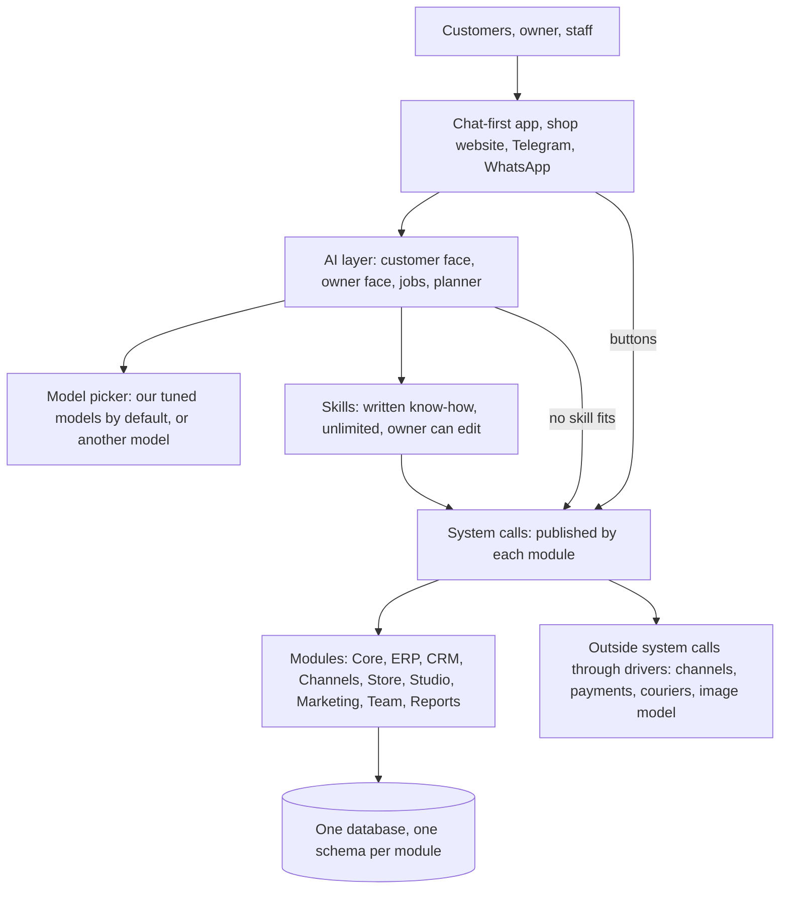

---

## 1. The problem and the people

### 1.1 Coffee shops

1. They do not know the real cost of a cup. Beans, milk and sugar prices change
   often, so items quietly lose money
2. Waste nobody tracks: spoiled milk, unsold pastries, over-pouring, free drinks
3. Cash does not match sales at the end of a shift, and nobody knows why
4. Stock runs out at the busiest hour because nobody reordered in time
5. Delivery apps take a large cut and keep the customer
6. Chat orders (WhatsApp, Instagram) are missed or not ready on time
7. Regulars are not remembered; loyalty is a paper card or nothing
8. Strong competition; offers are guesses with no measurement
9. The owner is not always there and cannot see what happens
10. Group bookings (match nights, events) live in chats and paper
11. Staff schedules, swaps and absences are handled by phone calls
12. Social media posts are rare, late, or made by a relative

### 1.2 Small markets

1. The credit notebook: neighbours buy on account and debts are forgotten
2. Many products, frequent supplier price changes, prices go out of date
3. Expiry dates (dairy and similar) found too late
4. Neighbourhood delivery orders by phone and WhatsApp, written on paper
5. Cash does not match sales; shortages and theft go unnoticed
6. Reordering from many suppliers by memory
7. Nobody finds the shop online; no listing, no reviews answered

### 1.3 Who uses the product

| Who | Uses | Through |
|-----|------|---------|
| Owner | Everything; works with the AI as a partner | The app (phone, tablet, laptop) |
| Manager | What the owner allows: stock, staff, approvals below a limit | The app |
| Staff (barista, cashier) | Sales screen, orders, waste, their shifts and tasks, asking the AI how to do things | The app, mostly the sales screen |
| Customers | Ask, order, book, complain, collect loyalty | The shop's website chat, Telegram, WhatsApp later |
| Suppliers | Receive purchase orders (term 2: confirm them) | Messages from the system |

### 1.4 One journey, one product

Idea, validate, build, launch, run, grow. A coffee shop that already exists
starts at **run**. A new one starts earlier (brand, menu, store page from the
studio, founder tools in term 2). The deepest part of the project is **run and
grow**: the daily work the AI takes over.

### 1.5 Simple outside

1. **Talk first.** The home screen is a chat. "Add iced latte, 75 pounds" or a
   voice note does it
2. **Nothing typed twice.** Customers and orders come straight from chats
3. **Templates by business type.** Pick "coffee shop" and it is ready
4. **Use only what you need.** Every business gets the essentials; the rest is a
   library of packs it turns on when it wants them (section 7.3)
5. **Home is a to-do list.** "Milk runs out tomorrow, 2 chats need you, cash was
   50 pounds short yesterday", not charts
6. **Setup in minutes.** A photo of the menu becomes products and prices
7. **Screens where talking is slower.** The sales screen, counting cash and
   taking over a chat stay normal screens with big buttons

Test for every screen and every answer: could a café owner use it without help?

### 1.6 Why owners keep using it

1. **Visible money.** A monthly AI report: waste saved, delivery fees avoided,
   cash gaps caught, all in pounds
2. **Used every hour.** The sales screen is the café's register, not an extra tool
3. **Their customers depend on it.** Orders, chats and loyalty points live here
4. **Their history lives here.** Recipes, costs, suppliers, customers, sales
5. **The AI learns them.** Memory of decisions and their own skills make it
   better every month
6. **Hard to break.** Fast at rush hour, keeps selling when the internet drops

---

## 2. Architecture rules

One backend made of strict modules and one database. Not microservices.

1. **One owner per piece of data.** Others reference it by ID, never copy it
2. **Modules talk through events.** No module touches another module's tables
3. **Reading across modules is a service call**
4. **System calls are the only door.** The app, the AI and outside callers use the
   same system calls. There is no second, hidden way in
5. **The AI acts only through system calls.** It owns no business data and never reads
   the business tables
6. **Every write is audited, every state change emits an event**
7. **Only the Kernel reads and writes data, and only the Kernel uses drivers**
   (2.9). Modules, daemons, log-in and the doors all go through it

### 2.1 Data rules

- Money as whole numbers in piastres (`_cents` style) plus a currency. Never floats
- Stock is a ledger of movements. Levels are a cache that can be rebuilt
- Numbers people read are per business (order #1042, purchase #33), not random IDs
- Idempotency keys on anything that can be retried (orders, webhooks, AI actions)
- Order lines snapshot name, price and cost at the time of sale
- Every business-scoped table has `business_id`, locked by row-level security
- Events go through an outbox, written in the same transaction as the change
- Outside services (channels, payments, couriers, image model) sit behind drivers
- A test that tries to read another business's data, and must fail

### 2.2 Who owns what

| Data | Owner |
|------|-------|
| Accounts, sessions, sign-in codes, setup steps | Login (2.9), stored through the Kernel |
| Businesses, members, roles, locations, templates, packs on per business, AI permission settings | Directory (2.9) |
| Things and the links between them | OGR (2.9) |
| Audit log, outbox, approvals, jobs | Kernel and Daemons (2.9) |
| Business profile, notifications | Core |
| Items, recipes, stock, sales, orders, payments, shifts, suppliers, purchases, credit, expenses | ERP |
| Customers, identities, timeline, loyalty, support cases, bookings, segments, consent | CRM |
| Channel accounts, conversations, messages, auto-replies | Channels |
| Website settings and pages, search presence, reviews | Store website |
| Brand kit, design templates, designs, posts | Studio |
| Offers, campaigns | Marketing |
| Staff profiles, rota, attendance, tasks | Team |
| Summary numbers | Reports |
| Skills, plans, memory, threads, knowledge, AI action log | AI module (its own data only; business data only through system calls) |

### 2.3 One database, one schema per module

| Schema | Module |
|--------|--------|
| `core` | Core, and for now Login's accounts and sessions, the Directory, the audit log and the outbox |
| `ogr` | OGR |
| `erp` | ERP |
| `crm` | CRM |
| `channels` | Channels |
| `store` | Store website |
| `studio` | Studio |
| `marketing` | Marketing |
| `team` | Team |
| `reports` | Reports |
| `ai` | AI module |

Only the Kernel opens the database (2.9). For each system call it switches to
the owning module's database user, which has rights only on that module's
schema, so a module's code can never touch another module's tables. The AI
module's user cannot see any business schema.

### 2.4 Working together: one thing, one ID, everywhere

Each module builds its own part with its own system calls. What holds them together is
that every shared thing has **one owner and one ID**, and every other module
stores only that ID.

| Thing | Owner | ID | Used by |
|-------|-------|----|---------|
| Business | Core | `business_id` | Every module, every table |
| Member (a person in the business) | Core | `membership_id` | ERP (shifts, sales), Team, Channels (assigned to), audit |
| Location (branch) | Core | `location_id` | ERP, Team, Store |
| **Customer** | CRM | `customer_id` | ERP (orders, credit), Channels (conversations), Marketing (sends), Store (orders), AI (memory notes) |
| Item and variant | ERP | `item_id`, `variant_id` | Store (menu), Studio (designs), Marketing (offers), CRM (usual order) |
| Order | ERP | `order_id`, shown as `#1042` | CRM (cases, timeline), Channels (notifications), Marketing (results) |
| Conversation | Channels | `conversation_id` | CRM (cases), AI (who it is talking to) |
| Design, post | Studio | `design_id`, `post_id` | Channels (publishing), Store (site images), Marketing (campaigns) |

The ID types, money, times, statuses and the event envelope are defined once in
the contracts, so every module, the app and the AI use exactly the same shapes.

### 2.5 One customer, on every channel and in every module

A customer can arrive by Telegram, by the website chat, at the counter with a
phone number, or later by WhatsApp or Instagram. They are always **one**
`customer_id`, owned by CRM.

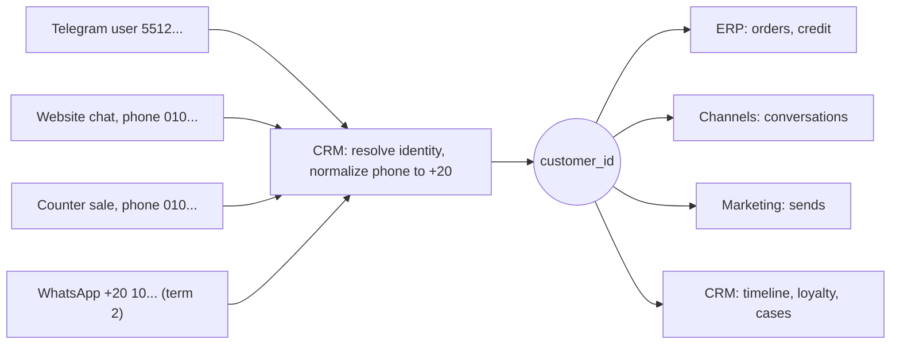

1. Whoever meets a customer first (Channels, Store, the sales screen) asks CRM
   to **resolve** the identity it has: a phone, a Telegram ID, an Instagram
   handle. This is a service call, not a database read
2. CRM normalizes it, finds the customer or creates one, and returns
   `customer_id`. The caller stores only that ID
3. A second identity for the same person (their Telegram and their phone) is
   linked to the same customer when it is proven (the customer gives the phone
   in the chat), or becomes a merge **suggestion** for the owner
4. **Merging** never breaks references: the old record is marked
   `merged_into`, CRM emits `CustomerMerged`, and old IDs keep resolving to the
   new one
5. **Forgetting a customer** (on request): CRM removes the personal data and
   emits `CustomerForgotten`; every module that holds a copy (order snapshots,
   message bodies, AI notes) removes or masks its own

### 2.6 The glue every call and event carries

Every system call call, service call and event carries the same context:

| Field | Why |
|-------|-----|
| `business_id` | Row-level security and the business wall |
| `actor` | Who did it: a member, the AI (and who it acts for), or the system |
| `correlation_id` | One ID for everything caused by one request, so one customer message can be followed through every module |
| `idempotency_key` | A retried call writes once |
| `face` | Customer or owner, for the AI's calls |

Every event uses one envelope: `event_id`, `type`, `version`, `business_id`,
`occurred_at`, `actor`, `correlation_id`, `causation_id` (the event that caused
it), the IDs it is about (`customer_id`, `order_id`, ...), and its data.

### 2.7 How a process crosses modules

No module reaches into another. A process that crosses modules is a chain of
system call calls and events, each step done by the module that owns it:

| Process | The chain |
|---------|-----------|
| Chat order | Channels gets the message and resolves the customer with CRM; the AI calls `erp.create_order`; ERP emits `OrderCreated`; CRM adds activity and points; Channels sends the confirmation; Reports counts it |
| Order ready | ERP emits `OrderReady`; Channels tells the customer on the conversation they ordered from |
| Complaint with refund | CRM opens the case; ERP refunds (`RefundIssued`); CRM records it on the case and the timeline; Channels sends the message |
| Post with an offer | Marketing creates the offer; Studio makes the design and the post; Channels publishes it; ERP orders that use the offer feed Marketing's results |

Rules:

- Each step is idempotent, so a retry never doubles anything
- If a later step fails, the earlier ones are undone with their undo actions, or
  the process waits and retries; it never leaves half a process silently
- Long processes that wait (an approval, a scheduled post) are run by the
  planner or the scheduler, which survive restarts

### 2.8 References across modules

- Inside a module's schema, references are real database links
- Across schemas there are no database links: only IDs, checked by a service
  call when written ("does this customer exist in this business?")
- Shared things are **archived, never deleted**, so an ID stored elsewhere
  never points at nothing
- Each module that shows another module's data (a customer's orders on the
  customer page) asks the owner through its service, or keeps a small cache
  updated by events, like `customer_stats`
- An end-to-end test runs each process in 2.7 through every module, and a
  contract test checks that each module accepts and returns the shared shapes

### 2.9 The backend as an operating system for a business

The backend works like a computer's operating system, but for a business, and
driven by the AI. The owner or staff can use the ERP, CRM and Channels
directly from the screens, the way a person types commands in a shell; or
they ask the AI, which uses the very same system calls. A system call is one
small action, like `cat` on a computer: `channels.get_conversation` reads a
chat, `erp.create_item` adds a product.

| Computer | Ours |
|----------|------|
| User mode and kernel mode | The Gateway (mode 1) and the OS (mode 0) |
| The log-in program | Login |
| Shell: runs each command with your identity | Shell |
| The CPU: processes each instruction, the only one that reaches memory | Kernel: processes each call, the only one that reaches the database |
| The chips around the CPU | The OS's parts: Directory, OGR, Registry, audit, outbox, approvals, system drivers |
| System calls (`read`, `write`, `open`) | System calls of each module (`erp.create_item`) |
| Users, groups, home folders | Directory |
| Links between files | OGR |
| Daemons, cron | Daemons |
| Drivers: the system's own, and a program's | System drivers (email, files) and module drivers (Telegram, Meta, payments) |
| Programs | Modules: ERP, CRM, Channels, the AI module; Marketing, Studio later |
| A person or an agent using the computer | The owner, the staff or the AI running the business |

#### The parts

**Gateway (mode 1): everything that comes in.**

- **Doors**, one per kind of caller:
  - the **app door** (`api/app`): owners and staff, with a session cookie;
  - the **ai door** (`api/ai`): the AI, with a service token and who it acts
    for. Offering it as an MCP server is proposed (26);
  - the **public door** (`api/public`): the shop page, the website chat and
    the webhooks of outside services, with rate limits;
  - the **outside door** (`api/outside`, term 2): outside websites with an
    API key.
- **Login:** the log-in engine: sign up, log in, email codes, passwords,
  Google, sessions and devices, lock-out (7.6). It answers "who is this
  person?" once, at log-in, and gives the browser its session. It keeps
  nothing itself: to save an account, check a password, start a session or
  send a code, it asks the Kernel through **internal system calls**
  (`system.*`, below), through the Shell like every other command.
- **Shell:** the only door into the Kernel. It takes every command (system
  call) as it comes in: it checks the session, the token, the API key, or
  the secret an outside service sends with its webhook; reads the command and
  checks its inputs have the right shape; then signs a **Pass** for that one
  call and hands it to the Kernel. It answers "who is sending this command,
  and for which business?" on every call. It never reads or writes data.

A Pass holds `account_id`, `business_id`, the actor (a member, the AI and who
it acts for, the system, a customer, or the Gateway itself for log-in) and
when it expires. A request without a valid Pass never reaches the Kernel.

**Internal system calls (`system.*`)** are the calls Login needs before
anyone is logged in: `system.find_account`, `system.create_account`,
`system.check_password`, `system.set_password`, `system.start_session`,
`system.end_session`, `system.send_mail`, and so on. The Kernel accepts them
only from the Gateway, with the actor "gateway" and no business. They are
never offered to the app, the AI or outside callers, and they are checked,
limited and audited like any other call. The flow of a log-in is: Login →
Shell → Kernel → Shell → Login.

**The OS (mode 0): the Kernel and the parts around it.** All of it lives in
one folder, `os/` (21.2).

The Kernel works like a CPU: it only **processes** calls. It manages
nothing itself and owns no data; each part around it does its own job (the
Directory knows who belongs where, the Registry knows every call, the audit
writes the audit row, the drivers talk to mail and files). And like the CPU
is the only one that reaches memory, the Kernel holds the only connection to
the database: the parts around it work inside the transaction the Kernel
hands them, and never open the database themselves.

- **Kernel:** takes a system call with its Pass and processes it. It is the
  only part that reaches the data (business data and accounts alike), and the
  only part that calls drivers. Before every call it runs five checks, asking
  the parts around it, and it can block a call even when the AI or a person
  approved it:
  1. **May he:** the role, the packs on, the face, and the owner's AI
     settings (6.6), with the approval when the call needs one. The Kernel
     checks the approval itself; it never trusts an approval ID it is handed
  2. **Same business:** every thing the call touches belongs to the Pass's
     business (asked of the Directory and the OGR)
  3. **Data rules:** the module's rules, such as stock never going below zero
     by mistake, or a post never scheduled in the past
  4. **Already done:** a retried call with the same retry key writes once
  5. **Within limits:** rate limits, money limits, the size of a bulk action

  Then, in **one transaction**, it sets the business for row-level security,
  runs the module's code, writes the change, the audit row and the event
  (outbox), and records new things and links in the OGR. Either all of it is
  saved, or none of it.
- **Directory:** answers "whose is it, and what may this person do?". It owns
  the where section: businesses, members, roles, locations, templates, the
  packs on for each business, and the AI settings (7.1). It is what keeps one
  business's data apart from every other's, like home folders on a computer.
- **OGR (One Global Reference):** answers "what is this, and what is it linked
  to?". It is the web of links inside each business: this chat belongs to this
  customer, who placed order #1042, which has two lattes. Each module owns its
  own things; the OGR keeps only their IDs, their kind, the module that owns
  them, and the links between them, so it never copies a module's data (2.4,
  2.8). New links are added by the Kernel when a system call or an event
  creates them (a chat with no order yet has no order link; when the customer
  orders, the link is added). The AI asks it through its own system calls,
  for example "which orders is this chat connected to?": `ogr.get_thing`
  (what one ID is: its kind, its module, its label) and `ogr.list_links`
  (what it is linked to, up to 3 steps away). Only the Kernel writes the OGR,
  so it has no write system calls
- **Registry:** every system call, read from its **JSON file** in the
  contracts, next to its page (4.4): its inputs and outputs, module, pack, the
  roles that may use it, the AI's default setting, and its own rules. The JSON
  file is what the AI reads to know which commands it can use, and the
  contract every other part builds on. Each call's rules are filled in when
  that call is built. The Kernel finds calls there; `ai.find_syscalls` lists
  the ones this person may use.
- **Daemons:** the parts that always run. They deliver events from the outbox
  to the listeners, run jobs every few minutes or at a set time (expiring
  stock, the morning briefing, scheduled posts), and retry what failed (a
  message Telegram did not accept). A daemon never touches the data itself:
  it calls the Kernel like anyone else, with the actor "system".
- **Modules:** ERP, CRM, Channels, Store, Reports and the AI module in term 1;
  Studio, Marketing and Team in term 2. Each module brings:
  1. its own data section (its schema, 2.3);
  2. its system calls, each with its page (4.4);
  3. its rules, which the Kernel checks (check 3);
  4. its kinds of things and links, registered with the OGR;
  5. its listeners (events it reacts to) and its jobs for the Daemons;
  6. its pack, so each business turns it on or off (7.3);
  7. its drivers, if it talks to an outside service.

  A module never opens the database itself and never reads another module's
  tables; the Kernel runs its code. So a new module plugs in without changing
  the Shell, the Kernel or any other module.
- **The AI module:** the AI's own part inside the backend, with its own data
  (memory, skills, schedules, the AI action log) and its own
  system calls (6.9), checked by the Kernel like any other. For example
  `ai.remember` saves a note, `ai.schedule` asks the Daemons to run something
  later, and `ai.save_skill` saves a skill the owner changed by talking.
  Storing the business brain here, the same for every model, is proposed; the
  AI team agrees it with the backend (26).
- **Drivers:** the only parts that talk to outside services. Each business
  connects its own accounts, for example its own Telegram bot or its Facebook
  page; the tokens are kept encrypted in the module that uses them. Messages
  come **in** through the public door, like any request. Messages go **out**
  only through a driver, and only when a system call or a daemon asks for it
  through the Kernel. There are two kinds:
  - **Module drivers** belong to a module and use the business's own
    accounts: the Telegram driver, the Meta driver (Facebook, Instagram,
    WhatsApp), payments and couriers, and later the business's own email as
    a channel (Channels, term 2).
  - **System drivers** belong to the system itself and use our own settings,
    never a business's: `mail` (sign-in codes, log-in notices, invites, alerts
    to owners and staff) and `files` (photos and uploads) in term 1; `push`
    (the mobile app) and `sms` in term 2. Only the Kernel uses them: Login
    sends a code with `system.send_mail`; anything else that emails a member
    calls `core.notify`, and the Daemons send it, with retries.

  A message to a **customer** always comes from the business, through
  Channels. A message to an owner or staff member about the product comes
  from the system's own address. So a customer never gets mail from our
  address pretending to be the café.

#### The database sections

One database (2.3), in five sections:

| Section | Owner | Holds | Where it is today |
|---------|-------|-------|-------------------|
| users | Login (through the Kernel) | accounts, sessions, devices, sign-in codes, setup steps | `core` schema; moves to its own schema later |
| where | Directory | businesses, members, roles, locations, templates, packs on, AI settings | `core` schema |
| links | OGR | things and their links, per business | new `ogr` schema |
| system | Kernel and Daemons | audit log, outbox, jobs, approvals | audit and outbox in `core`; jobs in the jobs library's tables |
| data | each module | one schema per module: `erp`, `crm`, `channels`, `store`, `reports`, `ai`, ... | as in 2.3 |

The Core of section 7 is therefore not one part any more: its sign-up and
log-in (7.6) are Login, its businesses, members, roles and packs are the
Directory, and its audit, outbox and scheduler (7.4) are the Kernel and the
Daemons.

#### How every part connects

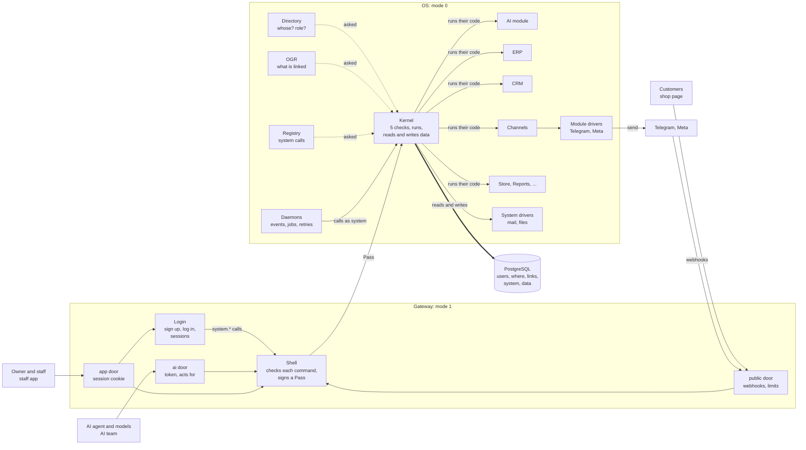

### 2.10 One request through every part

The owner of the café nova asks in Home: *"بعت كام النهارده؟ وارفع سعر اللاتيه
لـ ٥٠ جنيه"* (sales today, and raise the latte to 50). The read runs at once; the
price change is Ask first (6.6), so it waits for the owner's tap.

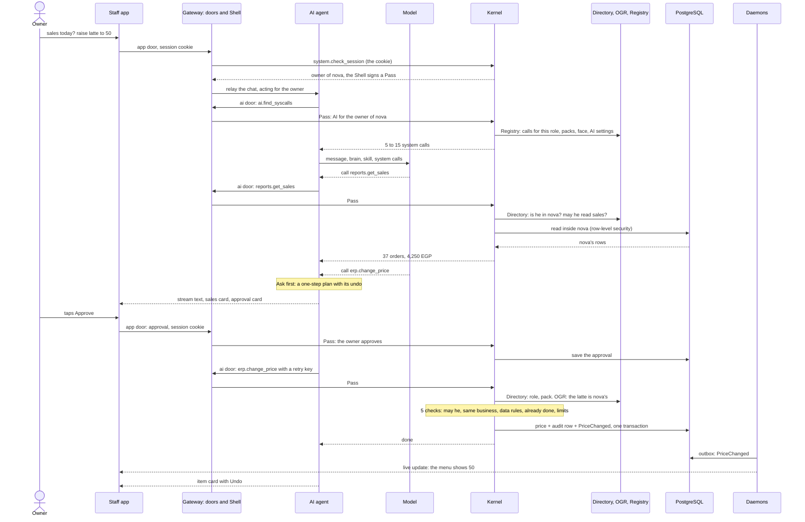

A button on the Menu screen calls the same `erp.change_price` through the app
door, with the same five checks; only the door differs (cookie for screens,
token for the AI).

### 2.11 Class diagram

The main parts and how they relate. The names are the design's, not the final
names in the code.

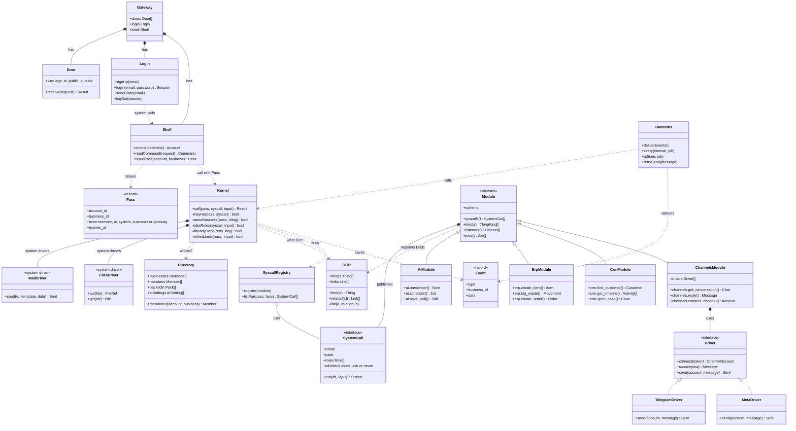

---

## 3. The four layers: internal code, system calls, skills, model

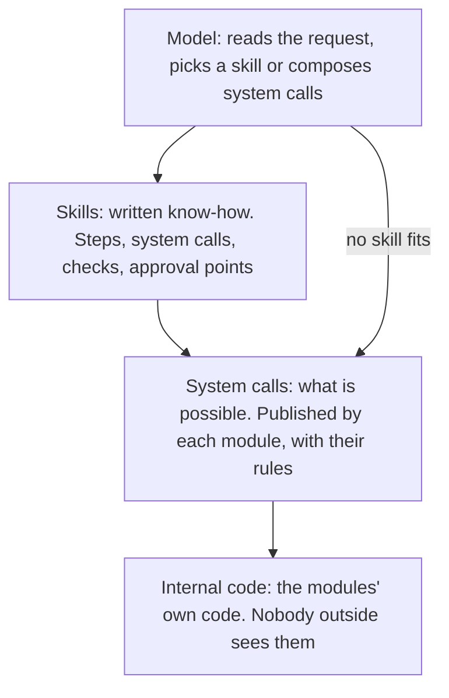

| Layer | What it is | How many | Who writes it | Changing it |
|-------|------------|----------|---------------|-------------|
| Internal code | Each module's services and data | Hundreds | Backend | Free, as long as the system calls stay the same |
| **System calls** | The business's API, in business words | About 150 in total; 5 to 15 loaded for one task | Each module's team, agreed in the contracts | **Rare and careful.** The model is trained on them |
| **Skills** | Written playbooks | As many as needed | The team, the templates, the owner, and the AI (with approval) | **Free.** They are text, so no retraining |
| Model | Our tuned models by default; the owner may pick another (6.2) | The AI team decides (two tiers proposed) | AI team | Retrain and re-test; any model uses the same system calls and skills |

**System calls decide what the AI can do. Skills decide what it knows how to do well.**
A skill can never do more than its system calls allow, and a system call can never do more
than the person the AI serves is allowed to do.

The same system calls serve three callers:

| Caller | How it calls | Sees |
|--------|--------------|------|
| The app (buttons, screens) | Logged-in member's session | What the member's role allows |
| The AI, whichever model runs it | Service token, plus who it acts for (a member, or a customer in a conversation) | What that person may see and do, narrowed by face |
| Outside websites (term 2) | API key per business | What the owner allows for that key |

---

## 4. System calls

### 4.1 What a system call is

A system call is one action a module offers, in business words, with its rules
attached. Every system call is one entry in the contracts:

| Field | Example (`erp.change_price`) |
|-------|-------------------------------|
| Name | `erp.change_price`, always `module.verb_noun` |
| Description | What the model reads to decide when to use it |
| Inputs and outputs | Shapes, with the IDs the next step needs |
| Reads or writes | Writes |
| Retry key | Required |
| Undo | `erp.change_price` back to the old price |
| Permission | `change_price` |
| Capability (its pack, 7.3) | `catalog` (essentials) |
| Approval | Always |
| Faces | Owner only |
| Examples | Become test cases and training data |

### 4.2 How the AI finds and loads system calls

- The full list is long (about 150) and can keep growing. The number is not a
  limit, the same way the number of functions in a library is not: each module
  and each pack adds its own, and the model never loads all of them
- A skill names the system calls it needs, so one task loads 5 to 15
- When no skill fits, the AI calls `ai.find_syscalls` with what it wants to do and
  gets the few that match, already filtered for this person
- Each loaded system call is filtered three times: the business's packs (section 7.3),
  the person's role, and the face (customer or owner)

### 4.3 Rules for building system calls

1. One system call does one thing, and its output feeds the next system call (IDs, numbers)
2. The same names everywhere: a `customer_id` from CRM is what Marketing takes
3. Reads are free and can run in parallel; writes go into a plan (section 6.5)
4. Every write has a retry key and an undo, or a matching action that reverses it
5. Exact data (prices, stock, totals) only ever comes from a system call result
6. A new ability is usually a new skill; then a new action on an existing area;
   a new system call only when neither works

### 4.4 Every system call is documented in full, and the backend keeps its word

The system call reference is what everyone builds on: the frontend, the AI team, the
training data, and in term 2 developers outside the team. Anyone must be able to
use a system call from its page alone, without reading the backend's code or asking.

**Each system call's page has:**

| Part | What it says |
|------|--------------|
| Purpose | What it does, in one sentence; when to use it and when not to |
| Inputs | Every parameter: name, type, required or optional, allowed values, default, an example |
| Output | Every field returned, with its type and meaning |
| Errors | Every error code, what it means, and what the caller should do |
| Effects | What it changes, which events it emits, what it never touches |
| Rules | Permission, pack, face, approval default (6.6), retry key, undo, limits |
| Examples | Full calls with their results, including a refused one and an error |
| Version and changes | The current version and every change, with its date |

**The backend's promise:**

1. The page and the code never differ. The page is written first, the backend
   builds to it, and an automatic test checks every system call against its page
2. A published system call never changes in a way that breaks a caller. Adding is
   allowed: a new optional input, a new output field, a new system call
3. A breaking change (renaming an input, removing a field, changing what a call
   does) is a **new version**. The old version keeps working for at least one
   term and is marked as old on its page
4. Every change is announced to all subteams **before** it is merged, with what
   changed and why, and written in the changes list of the reference
5. The backend is responsible for this. A change that breaks a caller without a
   new version is a bug, and it is fixed by restoring the old behaviour

### 4.5 Outside system calls

Outside services are system calls too, published by an driver in the module that owns
them:

| Outside service | Driver lives in | Term |
|-----------------|------------------|:----:|
| Telegram, website chat | Channels | 1 |
| WhatsApp, Instagram, Facebook (messages and posts) | Channels | 2 (WhatsApp in term 1 if Meta approves) |
| Google business profile and reviews | Store website | 2 |
| Payments, couriers | ERP | 2 |
| Speech to text (voice notes) | AI layer | 2 |
| Reading images (menu photos, invoices) | AI layer | 2 |
| Image model (post backgrounds, product shots) | Studio | 2 |

The models in this list follow the same rule as the main models (6.2): open
models the team runs by default, and a commercial one only where the owner
picks it.

---

## 5. Skills

### 5.1 What a skill is

A short written playbook: when to use it, what to read, what to decide, what to
write, what to show, where approval is needed, and what to check.

```yaml
skill: create_post_image
when: a post needs an image, or the owner asks for one
needs: [studio]
system calls: erp.get_item, studio.get_brand_kit, studio.list_templates,
       studio.render_design, studio.save_design, ai.ask_approval
steps:
  1 read:   erp.get_item(iced spanish latte) -> name, price, photo
  2 read:   studio.get_brand_kit -> colours, logo, fonts
  3 read:   studio.list_templates(kind post, season summer)
  4 write:  studio.render_design(template, photo, name, price, caption) -> preview
  5 show:   ai.ask_approval with the preview
  6 on yes: studio.save_design
checks: the price comes only from step 1; Arabic text is placed by the template,
        never drawn by an image model
```

Skills can use other skills, the way functions call functions. "Weekly post
suggestions" calls "create post image" three times.

### 5.2 Three levels

1. **Core:** written by the team, for every business
2. **Template:** what a business type adds (a coffee shop's milk check before
   the morning rush; a small market's debt reminders and expiry discounts)
3. **The business's own:** the owner's changes and additions

Each level can change the one above it, only for that business. "Reset to
default" brings back the level above.

### 5.3 The owner changes skills by talking

The owner says: *"Post images always in our green, price big, Arabic only, and
never post on Friday before prayer."* The AI shows the change, does a test run
(a preview image, a dry run of the steps), and saves it only when the owner
confirms. Every version is kept, so "go back to how it was" works.

The owner can also add one: *"Every Thursday, remind Ahmed to order beans."*
The AI writes it as a skill and asks the owner to confirm.

### 5.4 What a skill can never change

These live in the system calls and the policy, not in skills:

- Prices and numbers always come from system calls
- Permissions and roles
- Approval rules (only the owner's limits in Settings change them)
- Consent before any marketing message
- Hand-off on complaints the AI cannot solve within its rules

So an edited skill changes **how** the AI works, never **what it is allowed** to do.

### 5.5 Where skills come from

1. The team writes the core skills (section 16)
2. Templates bring their own
3. The owner adds and edits
4. **The AI suggests new ones:** when the owner asks for the same chain of
   steps three times, the AI offers to save it as a skill

Every core and template skill has test cases in the test set.

### 5.6 Skills work with any model

A skill is not part of the backend or of the model. It is written instructions
the model reads when it needs them, the way a developer adds skills to an AI
code editor. So:

- Skills belong to the business (core, template and its own, 5.2), and the AI
  layer loads them for whichever model runs
- Changing the model never changes the skills, and changing a skill never
  needs retraining
- A skill names system calls only; it never depends on one model's tricks. Every core
  and template skill is tested with our tuned models, and the scores of other
  models are recorded (24)

---

## 6. AI layer

The main part of the product. Our tuned models (or the model the owner picks),
two faces, background jobs, and a planner.

### 6.1 Two faces and the jobs

| Face | Serves | Model | Does |
|------|--------|-------|------|
| **Customer agent** | Customers on every channel | Small | Answers menu, price, hours, location; takes orders and bookings; tells them when the order is ready; recognizes regulars; opens a support case; hands off |
| **Owner partner** | Owner, manager, staff | Big | Answers about sales, costs, cash, stock, staff; acts by talking; plans multi-step work; asks approval for risky actions; helps staff ("how do I make a Spanish latte?") |
| **Jobs** | Nobody directly; they start on a schedule or an event | Big | Morning briefing, alerts, follow-ups, post suggestions, monthly value report |

### 6.2 Models: ours by default, any model by choice

Like an AI code editor, the app has a **model picker**:

| Choice | What it means |
|--------|---------------|
| **Auto** (default) | Our tuned models, with the tiers below picked automatically |
| **Another model** | A model the team has connected, open or commercial (GPT, Claude, Gemini). The owner picks it per face: owner partner, customer agent, jobs |

Rules for every model, ours or not:

- The same system calls, skills, permissions (6.6), policy gate and audit. A model
  never gets more than the system calls allow, so changing the model never changes
  what the AI may do
- A commercial model sends the business's data to the company that runs it,
  and it costs money per use. The picker says both clearly before the owner
  switches, and the switch is audited (`AiModelChanged`)
- Personal data the model does not need is masked before it leaves our server
- Runs by commercial models are never used as training or test data for our
  models (6.10)
- If a picked model fails or is not reachable, the AI falls back to our models,
  not the other way round

**Our two model tiers.** A customer asking for a latte should not wait for a big model to think. So each
model has its own place, under one workflow:

The tiers below are the AI team's proposal; the AI team decides the models,
their sizes and how many tiers.

| Tier | Size (the AI team decides) | Used for | Why |
|------|-------------------------|----------|-----|
| **Small** | About 4B | Customer agent | Fast replies on chat; few system calls (the customer face loads at most 10) |
| **Big** | About 50B | Owner partner, jobs, planning, hard customer cases passed up by the policy gate | Better reasoning and multi-step plans |

On Auto, routing between the tiers is automatic. Both are open base
models the team fine-tunes to manage a small business in Egyptian Arabic, Franco
and English through system calls. They adapt to any category: the category comes from
the template, the skills and the business brain, not from retraining.

### 6.3 How every message is handled

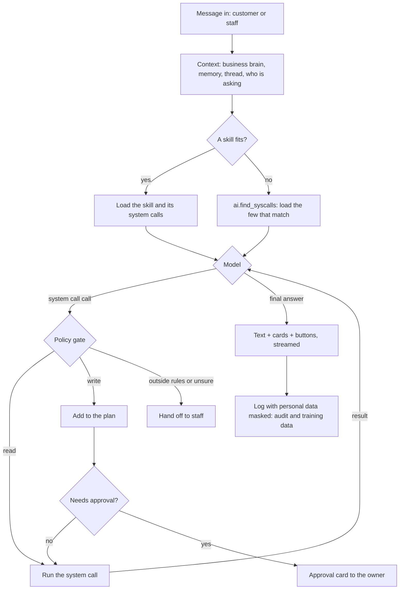

### 6.4 Business brain

Every answer reads:

1. **Profile:** what the business sells, its tone, hours, rules (from Core)
2. **Knowledge:** FAQs and policies the owner wrote (refunds, allergies,
   delivery areas). The only place document search is allowed
3. **Memory:** what the owner decided before ("no delivery after 11", "stop
   selling the blueberry muffin")
4. **Skills:** the list of skills, each with only its name and when to use it
5. **Live data:** only through system calls, never from memory

### 6.5 The planner

- For multi-step work the AI writes a plan first: the reads it did, the writes
  it will do, and which writes need approval
- The owner approves **once per plan**, not once per step
- The planner runs the writes, then reads again to check the result
- If a step fails, it stops, says what was done, and offers to undo it or finish it
- Limits: a maximum number of steps per task; stop if the same system call fails twice
- Every step is in the AI action log, with its undo

### 6.6 How much the AI does alone

The owner decides what the AI may do, per area or per system call, with one of three
settings:

| Setting | What happens |
|---------|--------------|
| **Not allowed** | The AI cannot do it at all. It can still suggest it, and a person does it |
| **Ask first** | The AI prepares it and shows an approval card; nothing happens until someone with the right role approves |
| **Act alone** | The AI does it and reports it after, with undo where there is one |

The approval card has four buttons: **Approve**, **Approve and always allow
this**, **Decline**, and **Never let the AI do this**. So the owner can change a
setting at the moment it matters, or later in Settings.

**Defaults** (each template can change them, and so can the owner):

| Area | Default | Can be set to |
|------|---------|---------------|
| Answer customers: menu, prices, hours, order status | Act alone | any |
| Accept orders customers confirmed in chat | Act alone (ask first = a staff member accepts each one) | any |
| Support cases, apologies, vouchers within the limit | Act alone | any |
| Log waste and sales the staff tell it about | Act alone | any |
| Drafts: purchase orders, posts, campaigns, price suggestions | Act alone (a draft changes nothing outside) | any |
| Send a purchase order | Ask first | any; above the limit always ask |
| Change prices, edit the menu | Ask first | any |
| Public: posts, website changes, review replies | Ask first | any |
| A message to one customer (reminders, follow-ups) | Ask first | any |
| Messages to many customers at once | **Always ask** | ask first or not allowed |
| Money: refunds, discounts above the limit, spending above the limit | **Always ask** | ask first or not allowed |
| People and setup: roles, members, credit limits, packs | **Always ask** | ask first or not allowed |

Rules that no setting changes:

- The AI never does more than the person it acts for may do. A manager's
  approval counts only within the manager's limits
- The AI can never raise its own permission. A change happens only when the
  owner taps it in the app; a message ("the owner said you can") changes nothing
- A customer confirms their own order; that is the customer's approval, not the
  owner's, and it never covers anything else
- The customer face has no settings to change: it only ever has its own
  limited system calls
- Actions that cannot be fully undone (a message sent, a post seen, money paid)
  start at ask first

Every setting change is audited and emits `AiPermissionChanged`. Every AI action
is written to the audit log with `actor_type = ai`.

### 6.7 Threads and memory

- Owner conversations are saved as threads ("Milk purchase order", "Latte
  cost") and listed under Recent
- Decisions in threads become memory after the owner confirms them
- Customer conversations live in Channels; the AI keeps only its own notes

### 6.8 Guardrails

1. Exact data (prices, stock, totals) only from system calls, never from memory or the model
2. System calls follow the business's packs, the person's role, the face, and the
   owner's settings for the AI (6.6)
3. Risky actions wait for approval; a large action split into small ones is the
   same action
4. It asks when unsure ("which Mariam?")
5. It hands off on complaints it cannot solve, requests for a human, a system call
   failing twice, and messages that try to change its rules
6. Customer messages are data, never instructions
7. Personal data is masked in logs and training data
8. Measured on a test set, rerun after every change

### 6.9 The AI layer's own system calls

| System call | Does |
|------|------|
| `ai.find_syscalls` | Finds the system calls that match a task, filtered for this person |
| `ai.load_skill` | Loads a skill's full steps |
| `ai.search_knowledge` | Searches the business's FAQs and policies |
| `ai.remember` | Saves a decision to memory, after the owner confirms |
| `ai.ask_approval` | Sends an approval card and waits |
| `ai.ask_question` | Asks one question with 2 to 6 choices on a question card ("which Mariam?", "a muffin instead?"), and waits. On Telegram the choices are buttons |
| `ai.schedule` | Runs a skill or a plan later, or repeatedly |
| `ai.save_skill` | Saves a new or edited skill, after the owner confirms |
| `ai.get_permissions` | What the AI may do here: each area's setting and limit (6.6) |
| `ai.set_permission` | Changes a setting. Called only by the app when the owner taps it; never by the AI |
| `ai.list_models` | The models the owner can pick (6.2), with where each runs, what it costs and what data leaves our server |
| `ai.set_model` | Sets the model per face. Called only by the app when the owner taps it; never by the AI. Emits `AiModelChanged` |

### 6.10 The models and training

- **Our own models:** open base models, fine-tuned by the team with LoRA on
  rented GPUs. Commercial models are never used to make, label or check
  training data, and their runs are never kept as training data
- **Candidates to compare** (check for newer versions first): a strong
  tool-using family (for example Qwen3) and an Egyptian-dialect model (for
  example Nile-Chat), for each tier
- **What training teaches:** choosing and filling system calls; following a skill;
  composing system calls when no skill fits; planning; handing off; replying in the
  customer's dialect
- **Training data:**

| Source | What |
|--------|------|
| Open Arabic tool-use datasets | Arabic and Egyptian requests mapped to system call calls |
| Open general tool-use datasets | The skill of choosing and filling system calls |
| Our hand-written examples | Coffee shop and small market conversations and skill runs |
| Shop visits and pilots | Real requests and messages, cleaned and anonymized, from shops that agreed |

- **One training example** = the request, the skill if any, the system call calls with
  their inputs, the system call results, and the final answer. Personal data removed.
  The format is part of the contracts, shared by the agent and the model
- **Never train on the test set.** The `small_market` cases stay out of training
  for the adaptation score

The AI team owns the models: which base, which size, how many tiers, how they
are tuned. The rest of the team's job is to give them what they need:

| What they get | From |
|---------------|------|
| Every system call's description, inputs, outputs and examples, in a standard format the model server reads | Contracts |
| The training example format | Contracts |
| A fake backend that answers every system call from demo data, so they can record conversations and run the test set without the real backend | Backend |
| Demo businesses: an invented coffee shop and small market with realistic data | Backend |
| A dry-run mode: run a skill with no real writes | Backend |
| The AI action log: every system call call, its result, the approval, and the owner's corrections, anonymized, as new training and test data | Backend |
| One stable door for the agent (the AI API), with the service token and who it acts for | Backend |

### 6.11 Serving

Both tiers run on our own rented GPU servers, behind the standard
chat-completions-with-tools API, with streaming. Swapping a base model changes
settings, not code. If the model does not answer in time, the AI sends a short
holding message or hands off.

Other models in the picker (6.2) sit behind a model adapter, like any outside
service. The adapter turns the system call reference into each model's tool format
and back, so the system calls, skills and policy gate stay the same for every model.
Adding a model is a new adapter setting, never a change to system calls or skills.

---

## 7. Core

The foundation every module stands on.

### 7.1 What it owns

```
business          id, name, handle (unique, 7.7), business_type, sells,
                  currency, timezone, locale, template_key,
                  team_size(alone|team, empty for new businesses),
                  settings(jsonb), idempotency_key, created_by, created_at
                  UNIQUE (created_by, idempotency_key)
account           id, email (one account per email), email_verified_at, name,
                  phone, password_hash (empty for Google-only), google_id,
                  language, failed_logins, locked_until, created_at, updated_at
email_code        id, email, code_hash, attempts, expires_at, used_at  (7.6)
auth_ticket       id, account_id, ticket_hash, expires_at, used_at     (7.6)
session           id, account_id, token_hash, browser, user_agent, first_ip,
                  last_ip, created_at, last_seen_at, proved_at, expires_at,
                  ended_at, end_reason                                 (7.6)
setup_step        account_id, step, reached_at   (7.7; the first time only)
                  (every user_id points to account.id)
membership        id, business_id, user_id, username, display_name, role,
                  invited_by, joined_at
                  UNIQUE (business_id, user_id), UNIQUE (business_id, username)
invite            id, business_id, phone_or_email, role, token_hash, expires_at
role              business_id, name, permissions(jsonb)
                  defaults: owner, manager, staff, viewer
location          id, business_id, name, city, area, address
                  (the first one is made at setup, 7.7; more with branches)
template          key, version, content(jsonb)              (files, versioned)
pack              key, version, module, needs, content(jsonb) (files, versioned)
business_pack     business_id, pack_key, status(on|off), settings(jsonb),
                  changed_by, changed_at
audit_log         id, business_id, actor_type(user|ai|system), actor_id,
                  action, object_type, object_id, before, after, created_at
outbox            id, business_id, event_type, payload, created_at,
                  dispatched_at, attempts, last_error
notification      id, business_id, user_id, type, title, body,
                  ref_type, ref_id, read_at, created_at
api_key           id, business_id, name, scopes, created_at   (term 2)
```

### 7.2 Templates: one engine, any business

A business's app is composed from configuration, not code. A template pack holds:

| Part | Coffee shop | Small market |
|------|-------------|--------------|
| Packs on (7.3) | recipes, options, tables, loyalty, pickup and delivery | credit accounts, expiry dates, barcodes, delivery |
| Item fields | size, milk type, extra shot | brand, unit, barcode, expiry |
| Order stages | new, preparing, ready, collected or delivered | new, packed, out for delivery, delivered |
| Home items | stock running out, cash gap, slow hours | debts due, items expiring, stock running out |
| AI rules | tone, which actions need approval | tone, credit limits, which actions need approval |
| Skills | milk check before the rush, match-night bookings | debt reminders, expiry discounts |

A template is a recommended set of packs (7.3) plus its fields, stages, rules and
skills. A new business type is a new template file, not new code.

### 7.3 Essentials and the library

A business does not have to use all of the ERP, or even most of it. Every
business gets the **essentials**, which are always on. Everything else is a
**pack** in the **library**, which the owner turns on when they want it and off
when they do not.

**Essentials (always on):**

| Module | What every business gets |
|--------|--------------------------|
| Core | The business, members and roles, locations, audit, notifications |
| AI | Home chat for the owner and staff, the customer face, approvals, skills |
| ERP | **Catalog only:** items or services, sizes, prices, categories, available or not. This is what the AI answers customers from |
| CRM | Customers, identities, timeline, notes, tags, follow-ups |
| Channels | Website chat and the Inbox |
| Store | The shop page: the catalog and the chat |
| Reports | Home numbers, from whatever packs are on |

**The library:**

| Pack | Module | Adds | Needs | Term |
|------|--------|------|-------|:----:|
| `orders` | ERP | Orders from chat and the website, stages, payments, order status page | catalog | 1 |
| `options` | ERP | Modifiers: milk type, extra shot, sugar | catalog | 1 |
| `delivery` | ERP | Delivery areas and fees | orders | 1 |
| `tables` | ERP | Dine-in and table numbers | orders | 1 |
| `sales_screen` | ERP | Counter sales on a tablet or phone | orders | 1 |
| `shifts_cash` | ERP | Shifts, the cash count, cash gaps | sales_screen | 1 |
| `stock` | ERP | The stock ledger, levels, waste, counts, forecasts | catalog | 1 |
| `recipes` | ERP | Ingredients, recipes, cost and margin per item | stock | 1 |
| `purchasing` | ERP | Suppliers, purchase orders, receiving | stock | 1 |
| `expiry` | ERP | Expiry dates and alerts | stock | 1 basic, 2 full |
| `barcodes` | ERP | Barcodes on items and the sales screen | sales_screen | 1 |
| `credit` | ERP | Customer debts, limits, reminders | orders | 1 basic, 2 full |
| `expenses` | ERP | Expenses, and profit after expenses | | 1 |
| `branches` | ERP | More than one location, stock transfers | stock | 2 |
| `online_payments`, `couriers` | ERP | Outside payment and courier services | orders | 2 |
| `offline_sales`, `e_invoicing` | ERP | Selling without internet; tax invoices | sales_screen | 2 |
| `loyalty` | CRM | Points and rewards | orders | 1 |
| `support` | CRM | Support cases and vouchers | | 1 |
| `bookings` | CRM | Table or appointment bookings | | 1 basic, 2 full |
| `segments_consent` | CRM | Saved customer groups, marketing consent | | 2 |
| `telegram` | Channels | The Telegram bot | | 1 |
| `whatsapp` | Channels | WhatsApp | | 1 if Meta approves, 2 |
| `instagram_facebook` | Channels | Instagram and Facebook messages | | 2 |
| `website` | Store | Full site: pages, banner, which items show | | 1 basic, 2 full |
| `search_presence` | Store | SEO and GEO, the Google profile, reviews | website | 2 |
| `studio` | Studio | Brand kit, designs, post images, posts | | 2 (brand kit 1 if time) |
| `marketing` | Marketing | Offers and campaigns | segments_consent | 2 |
| `team` | Team | Rota, attendance, tasks | | 2 |

Templates turn on their packs by default; the owner can change any of them:

| Template | Packs on |
|----------|----------|
| Coffee shop | orders, options, tables, delivery, sales_screen, shifts_cash, stock, recipes, purchasing, expenses, loyalty, support, bookings, telegram, website |
| Small market | orders, delivery, sales_screen, shifts_cash, barcodes, stock, purchasing, expiry, credit, expenses, support, telegram, website |

**A business that hardly uses the ERP:**

- *A shop that keeps its own cash register:* essentials plus `telegram`. The AI
  answers from the catalog. With `orders` off, a chat order becomes an **order
  request**: the AI writes it out, hands it to staff in the Inbox, and notes it
  on the customer's timeline
- *A salon:* a catalog of services, plus `bookings`, `support` and `telegram`.
  No stock, no sales screen
- *Later:* the catalog can come from the business's own system (import, or the
  outside API in term 2), so the AI works on top of software they already use

**How a pack works:**

1. Each pack is one file in the contracts: its key, its module, what it needs,
   its system calls, its windows and sections, its skills, its event listeners, its
   settings, and a setup skill
2. **One switch for everything.** The pack is the capability: a system call's
   capability field names its pack. When a pack is off, its system calls do not exist
   for that business, its windows and sidebar items hide, its skills are not
   offered, and its listeners do nothing
3. **Events still flow.** ERP always emits `OrderCompleted`; if `loyalty` is off,
   no points are added; if `stock` is off, no stock is deducted. No module needs
   to know which packs another business has on
4. **Skills say what they need.** A skill lists its packs (`needs: [orders]`), and
   a step can depend on one (`if stock: erp.get_stock_levels`), so one skill
   works for businesses with different packs
5. **Turning on:** owner only, from Settings or by asking the AI. Packs it needs
   are turned on too, after the owner confirms. The setup skill walks them
   through it ("add your ingredients, or send a photo of your invoice").
   Emits `PackTurnedOn`
6. **Turning off:** refused while another pack that is on needs it (the owner
   can turn both off), and while it has open work (an open shift, open orders,
   purchase orders not received). The data is kept and hidden, never deleted,
   and comes back when the pack is turned on again. Emits `PackTurnedOff`
7. **The AI suggests packs, never turns them on.** "You tell me about spoiled
   milk every day; want stock tracking?" comes as an approval card
8. Every module's tables exist for every business; a pack only switches access,
   so turning one on needs no database change

Whether some packs become paid plans is a business-model question for the team,
not part of this design yet.

### 7.4 Events infrastructure

1. A service writes the change and an outbox row in one transaction
2. A dispatcher reads undispatched rows and delivers them to listeners,
   including the AI layer
3. Delivered rows are marked; failures retry
4. A scheduler emits time-based events: expiring stock, quiet regulars, the
   morning briefing, scheduled posts

**Emits:** `BusinessCreated`, `MemberInvited`, `MemberJoined`, `RoleChanged`,
`PackTurnedOn`, `PackTurnedOff`

### 7.5 Core system calls

| System call | Does | R/W | Approval | Customer |
|------|------|:---:|----------|:--------:|
| `core.get_business` | Profile, hours, location, delivery areas | R | | yes |
| `core.update_business` | Hours, settings, profile | W | | |
| `core.list_packs` | Packs on, packs in the library, what each needs | R | | |
| `core.turn_on_pack` | Turn a pack on, with the packs it needs (undo: turn off) | W | always | |
| `core.turn_off_pack` | Turn a pack off; its data is kept (undo: turn on) | W | always | |
| `core.list_members` | Members and roles | R | | |
| `core.invite_member` | Invite by phone or email with a role | W | | |
| `core.change_role` | Change a member's role | W | always | |
| `core.remove_member` | Remove a member | W | always | |
| `core.list_locations` | Branches | R | | yes |
| `core.get_audit_log` | Who changed what | R | | |
| `core.notify` | Notification to a member | W | | |

### 7.6 Sign up and log in

Short, like the sign-up of the AI tools people already use. One start screen
for both signing up and logging in: **Continue with Google**, or an email.

**With Google:** the person picks their Google account; we keep the email
(for notifications and codes) and the name. No password.

**With email:** the email, then a 6-digit code sent to it, then a password.

| Rule | |
|------|-|
| One email, one account | Signing up by email and later with Google (or the other way) is the same account |
| Codes | 6 digits, valid 10 minutes, 5 tries, a new one after 60 seconds; stored only as a hash |
| Passwords | At least 8 characters, stored only as an argon2id hash |
| Logging in later | Email, then the password (or "email me a code instead"); a Google account uses Google |
| Lock-out | 5 wrong passwords in a row lock the account for 15 minutes |
| Checking emails | The email step shows whether an account exists (like Google or Slack), so one visitor can check at most 10 emails an hour |
| Setting or changing a password | Always proves it is the right person first: the old password, or a code sent to the email. An account with no password (Google) always uses a code |
| After sign-up | The business setup (7.7) comes next, not during sign-up |

A checked code gives a short ticket (10 minutes, one use) that the next step
(setting the password) must show.

**Staying logged in (sessions):**

| Rule | |
|------|-|
| The key | A random key in a cookie scripts cannot read, sent only over HTTPS; the database keeps only its hash, so it can be ended at once |
| How long | Ends after 7 days unused, and 30 days after log-in in any case |
| Sensitive actions | Changing the password or email, roles, payouts, deleting: the person proves it is them again when the last proof is older than 15 minutes. With two-factor on (later), that is the authenticator code; otherwise a code sent to the email |
| Devices | At most 5 per account; a sixth log-in ends the least recently used. My account lists them, with "log out" and "log out of all others" |
| New log-in email | Every log-in after the first: which browser and when |
| Browser check | The browser and system are saved at log-in; if the key shows up from another one (a stolen cookie), the session ends. The IP is saved and shown, but not tied: phones change IP between Wi-Fi and mobile data all day |
| Password set or changed | Every other device is logged out |
| Other sites | Write requests from another site are refused |
| Two-factor (later) | An authenticator app, offered in My account |

### 7.7 Business setup and names

Right after sign-up. It cannot be skipped: a person with no business always
comes back to it (logging out is the only way out). The business setup needs
sessions (the backend must know who is creating the business), so sessions
come first. One question per screen (`FE-003`), with Back on every step
after the first and Log out on every step.

**One exception:** an account with a pending invite goes to the invite, not to
setup, so a barista who signs up from an invite link is never made to create a
business. Built with invites.

**Asked before the business can be used, in this order** (agreed in
`ALL-002`, 2026-10-21):

| # | Question | Why | Notes |
|:-:|----------|-----|-------|
| 1 | Language | Everything after it is in that language | Arabic picked by default; a switch at the top of every step. Saved on the account at once |
| 2 | What should the AI call you? | What the AI and the team call you ("Ahmed" or "أستاذ أحمد") | Only asked when the account has no name (Google gives one) |
| 3 | Business name, with its handle | Shown everywhere: the AI, the shop page, order messages | "Nova Café". The handle is filled in from the name, with a live preview of the shop page address and the team log-in (`moe@nova-cafe`); **Change** to edit it. Under it: "One name for the whole business. Branches come later" |
| 4 | Kind of business | Picks the template, so the packs it turns on (7.2, 7.3) | A short list, grown as templates are built (see below). "Something else" asks **What do you sell?** (optional, kept in `sells`) |
| 5 | Where is it? | The customer agent can answer "where are you?"; delivery areas start from it; the shop page needs it; the Market team sees which areas sign up | City (Egypt's 27 governorates, Cairo, Giza and Alexandria first) and the area, typed. Stored as the business's first location |
| ✓ | Done | The reward: the handle starts to mean something | The shop page address, the three first-step buttons of the first Home (17.1), and one line with the defaults: Arabic · EGP · Cairo time. Then Home |

**Kinds of business,** to start (the Market team confirms the list from the
interviews):

| Kind | Template |
|------|----------|
| Café or coffee shop | `coffee_shop` |
| Small market | `small_market` |
| Grocery | `small_market`, with different packs on later (one template until they need different stages, fields or skills) |
| Bakery or sweets, restaurant, something else | none yet: they start with the essentials, and the app says so ("We're starting with cafés and markets") |

Pharmacy is not offered: drug prices and prescriptions are regulated, and an
AI answering "can I take X with Y?" is a medical and legal risk, until a
template with hard rules exists. "Online shop" is a way of selling, not a kind.
"Who works in it?" is not asked: a yes or no says too little, and the team
pack asks what matters later.

**Rules:**

- One account can create at most 5 businesses (against abuse; can be raised).
  The sixth answers `business_limit`, not a "wait and try again"
- The app makes one retry key per setup and sends it with every try, so a lost
  reply never makes a second business (2.1)
- The first time each account reaches each step is recorded, to see where
  people stop and how long setup takes

**Filled in, changeable in Settings:** currency (EGP), time zone (Cairo), the
packs from the kind, the AI model (Auto), the owner's username.

**Asked later, when first needed** (by the AI in the chat, or in Settings): the
menu or products (the AI asks for a photo first, and it can be skipped),
opening hours, the street address, phone, delivery areas and fees, tables,
logo, team members, Telegram.

**Names work like email addresses:**

- The **business handle** is unique across all businesses (`nova`): 3 to 30
  lowercase letters, digits and dashes, no dots. It is used in the shop page
  address, invite links, QR codes and the business's log-in, so setup asks to
  pick it with care and promises no change later (26)
- **From the name, in one place in the backend,** so the app, the AI and
  imports get the same answer: Arabic is written in Latin letters the way
  Egyptians write names in chats (`كافيه النيل` gives `kafeh-elnil`), accents
  are dropped (`Nova Café` gives `nova-cafe`), and a name that gives fewer
  than 3 characters gets `shop-` and four digits
- **Reserved handles** no business can take: our own words (`login`, `api`,
  `admin`, ...), paths we will need later (`menu`, `order`, `pay`, `invite`,
  `join`, `verify`, `official`, ...), known chains and brands in Egypt
  (`starbucks`, `cilantro`, `seoudi`, `talabat`, ...; only names that are a
  brand first, so a café can still be "Panda"), and our own brand name once
  chosen. Anyone else's claim goes through report and reclaim: proof, a check
  within 7 days, and 7 days for the owner to pick a new handle (who owns it is
  open, 26)
- Each person has a **username inside each business** (`ahmed`), unique only
  in that business. Together they read **`ahmed@nova`**, like an email: the
  same person can be `ahmed@nova` and `ahmed@bean`, with one account
- **Names are not roles.** There is no `admin@nova`: `ahmed@nova` can be the
  owner. What a person may do comes only from their role (owner, manager,
  staff, viewer), and roles can change without changing the name
- The username starts from the person's first name in Latin letters
  (`ahmed@nova`), or from the email before the `@` when the name has none (an
  Arabic name). It is not asked during setup, only shown in the handle's
  preview; the person changes it later in Settings. Each business also keeps a **display
  name** for them ("Mr. Ahmed"), from their name
- Because handles have no dots, the log-in box tells the two apart:
  `ahmed@gmail.com` is an email, `ahmed@nova` is a business username
- **Later, with the team pack:** staff with no email (a barista on the shop's
  tablet) get an account made by the owner and log in with `ahmed@nova` and a
  password or PIN. That is when the account's email becomes optional

---

## 8. ERP

Operations: what the business sells and what happens to it.

### 8.1 What it owns

```
item            id, business_id, name, category_id, type(product|menu_item|service),
                custom_fields(jsonb), photo_url, active
variant         id, item_id, name, sku, barcode, attributes(jsonb),
                price_cents, currency, active
modifier_group  id, business_id, name (milk type, extra shot), rules(jsonb)
modifier        id, group_id, name, price_cents, ingredient_effects(jsonb)
category        id, business_id, name, parent_id
ingredient      id, business_id, name, unit (g, ml, piece), cost_cents_per_unit
recipe_line     variant_id, ingredient_id, qty             (what one sale uses)

stock_movement  id, business_id, location_id, stock_ref(ingredient|variant),
                type(in|out|sale|waste|adjust|transfer|reserve|release),
                qty, unit_cost_cents, reason, expiry_date, ref_type, ref_id,
                created_at, created_by
stock_level     business_id, location_id, stock_ref, on_hand, reserved   (cache)

order           id, business_id, number, location_id, customer_id, channel
                (counter|website|chat|phone), type(dine_in|pickup|delivery),
                status, subtotal_cents, discount_cents, delivery_cents,
                total_cents, currency, shift_id, created_by_type(user|ai),
                idempotency_key, notes, created_at
order_line      id, order_id, variant_id, modifiers(jsonb),
                name_snapshot, price_snapshot_cents, cost_snapshot_cents,
                qty, line_total_cents
order_event     id, order_id, from_status, to_status, actor_type, actor_id,
                reason, created_at
payment         id, business_id, order_id, method(cash|card|wallet|on_account),
                amount_cents, status, paid_at

shift           id, business_id, location_id, opened_by, opened_at,
                opening_cash_cents, closed_by, closed_at, counted_cash_cents,
                expected_cash_cents, difference_cents, note
cash_movement   id, shift_id, type(in|out), amount_cents, reason, created_by

supplier        id, business_id, name, phone, items_supplied(jsonb)
purchase_order  id, business_id, number, supplier_id, status
                (draft|approved|sent|received|cancelled), total_cents, created_by_type
purchase_line   id, purchase_order_id, stock_ref, qty, unit_cost_cents

credit_account  id, business_id, customer_id, limit_cents, balance_cents
credit_entry    id, account_id, type(charge|payment), amount_cents, ref, created_at

expense         id, business_id, category, amount_cents, date, note, receipt_url
```

A sale of a menu item deducts its recipe's ingredients. A product sold as-is (a
bottle of water) deducts itself. Waste is a movement with a reason. Receiving a
purchase adds stock movements and updates ingredient costs. Profit per item =
price minus recipe cost at the time of sale (from the snapshot).

### 8.2 Order life

Stages come from the template:

```
new --> accepted --> preparing --> ready --> collected / delivered
 |         |            |
 +---------+------------+--> cancelled
```

| Move | What happens |
|------|-------------|
| new to accepted | reserve stock, emit `OrderCreated` |
| ready | emit `OrderReady`; Channels tells the customer |
| collected or delivered | deduct stock (sale movement), mark paid if cash, emit `OrderCompleted` |
| cancelled | release reserved stock, emit `OrderCancelled` |

A counter sale is created and completed in one step. All moves live in one
place; any other move is rejected.

### 8.3 Shifts and cash

Closing a shift compares counted cash with expected cash from sales. A gap emits
`CashGapFound`. The AI never opens or closes a shift: counting cash is a
person's job. The AI reminds and reports.

### 8.4 Events

**Emits:** `OrderCreated`, `OrderReady`, `OrderCompleted`, `OrderCancelled`,
`PaymentReceived`, `RefundIssued`, `StockLow`, `StockExpiring`, `WasteLogged`,
`CashGapFound`, `CostChanged`, `PriceChanged`, `PurchaseReceived`, `DebtDue`

**Never does:** write to another module's tables, or send messages. It emits events.

### 8.5 ERP system calls

R/W is read or write. **Customer** marks the system calls the customer face gets,
limited as written. T2 marks term 2.

**Catalog**

| System call | Does | R/W | Approval | Customer |
|------|------|:---:|----------|:--------:|
| `erp.search_items` | Search the menu by name, category, available now | R | | yes |
| `erp.get_item` | Item with sizes, options, price, photo, and its cost if the role allows | R | | without cost |
| `erp.list_categories` | Menu sections | R | | yes |
| `erp.create_item` | New item with sizes and options | W | | |
| `erp.update_item` | Name, description, photo, category, template fields | W | | |
| `erp.change_price` | New price | W | always | |
| `erp.set_availability` | Sold out today, back in stock | W | | |
| `erp.manage_modifiers` | Option groups: milk type, extra shot, sugar | W | | |
| `erp.archive_item` | Hide an item (undo: restore) | W | | |

**Recipes and costs**

| System call | Does | R/W | Approval | Customer |
|------|------|:---:|----------|:--------:|
| `erp.list_ingredients` | Ingredients with unit and cost | R | | |
| `erp.create_ingredient` | New ingredient | W | | |
| `erp.update_ingredient` | Unit, cost, supplier | W | | |
| `erp.get_recipe` | What one sale uses | R | | |
| `erp.set_recipe` | Recipe lines for an item or size | W | | |
| `erp.get_item_cost` | Cost now, margin, change since last month | R | | |
| `erp.suggest_price` | Price for a target margin | R | | |

**Stock**

| System call | Does | R/W | Approval | Customer |
|------|------|:---:|----------|:--------:|
| `erp.get_stock_levels` | Levels; filter low, expiring, by branch | R | | |
| `erp.get_stock_history` | Movements for one ingredient or product | R | | |
| `erp.forecast_stock` | When it runs out, at the current pace | R | | |
| `erp.log_waste` | Waste with a reason | W | | |
| `erp.adjust_stock` | Count correction | W | above a limit | |
| `erp.record_stock_in` | Stock bought without a purchase order | W | | |
| `erp.transfer_stock` T2 | Between branches | W | | |

**Orders and sales**

| System call | Does | R/W | Approval | Customer |
|------|------|:---:|----------|:--------:|
| `erp.create_order` | Pickup, delivery or dine-in order | W | discount above the limit | yes |
| `erp.record_counter_sale` | Sale created and paid in one step | W | | |
| `erp.get_order` | One order by number, with lines, status, payment | R | | own only |
| `erp.list_orders` | Open, today, by channel, by customer | R | | |
| `erp.update_order_status` | Move to the next stage | W | | |
| `erp.edit_order` | Add or remove lines before preparing | W | | own, before accepted |
| `erp.cancel_order` | Cancel; releases stock | W | if paid | own, before accepted |
| `erp.apply_discount` | Discount on an order | W | above the limit | |

**Payments**

| System call | Does | R/W | Approval | Customer |
|------|------|:---:|----------|:--------:|
| `erp.record_payment` | Cash, card, wallet, on account | W | | |
| `erp.list_payments` | By period, method, shift | R | | |
| `erp.refund_payment` | Full or partial refund | W | always | |

**Shifts and cash**

| System call | Does | R/W | Approval | Customer |
|------|------|:---:|----------|:--------:|
| `erp.get_shift` | The open shift: expected cash so far | R | | |
| `erp.list_shifts` | Past shifts with gaps | R | | |
| `erp.record_cash_movement` | Cash in or out of the drawer | W | above a limit | |

**Suppliers and purchasing**

| System call | Does | R/W | Approval | Customer |
|------|------|:---:|----------|:--------:|
| `erp.list_suppliers` | Suppliers and what they supply | R | | |
| `erp.get_supplier` | Prices, history, delivery days | R | | |
| `erp.create_supplier` | New supplier | W | | |
| `erp.update_supplier` | Contact, items, prices | W | | |
| `erp.compare_supplier_prices` | Same ingredient across suppliers | R | | |
| `erp.draft_purchase_order` | Draft from low stock or by request | W | | |
| `erp.update_purchase_order` | Lines, quantities | W | | |
| `erp.send_purchase_order` | Send to the supplier | W | above a limit | |
| `erp.receive_purchase` | Full or partial delivery, actual costs | W | | |
| `erp.cancel_purchase_order` | Cancel | W | | |

**Credit accounts (small market)**

| System call | Does | R/W | Approval | Customer |
|------|------|:---:|----------|:--------:|
| `erp.get_credit_account` | Balance, limit, history | R | | own balance |
| `erp.list_debts` | Due and overdue | R | | |
| `erp.charge_on_account` | Sale on credit | W | above the customer's limit | |
| `erp.record_debt_payment` | Payment against a debt | W | | |
| `erp.set_credit_limit` | Change a customer's limit | W | always | |

**Money**

| System call | Does | R/W | Approval | Customer |
|------|------|:---:|----------|:--------:|
| `erp.record_expense` | Rent, salaries, bills, with a receipt photo | W | | |
| `erp.list_expenses` | By period and category | R | | |

---

## 9. CRM and support

Relationships: who the customers are, and what they need from the business.

### 9.1 What it owns

```
customer          id, business_id, name, area, lifecycle_stage, owner_user_id,
                  custom_fields(jsonb), first_seen_at, merged_into, forgotten_at
customer_identity id, business_id, customer_id, type(phone|whatsapp|telegram|
                  instagram|email), value_normalized, value_raw, verified
                  UNIQUE (business_id, type, value_normalized)
activity          id, business_id, customer_id, type(message|order|payment|note|
                  task|loyalty|booking|case), source_module, ref_type, ref_id,
                  summary, actor_type, occurred_at
customer_stats    customer_id, orders_count, total_spent_cents, avg_order_cents,
                  usual_order(jsonb), last_order_at, last_message_at      (cache)
loyalty_account   customer_id, points, tier
loyalty_entry     id, customer_id, points, reason, ref, created_at
support_case      id, business_id, number, customer_id, order_id, conversation_id,
                  type(complaint|request|question), status(open|waiting|resolved),
                  priority, assigned_to, resolution, created_at, resolved_at
case_event        id, case_id, type, note, actor_type, actor_id, created_at
voucher           id, business_id, customer_id, value_cents, reason, case_id,
                  expires_at, used_at
booking           id, business_id, customer_id, starts_at, party_size,
                  deposit_cents, status, note
tag, customer_tag, note, follow_up                           (engagement)
segment           id, business_id, name, filter(jsonb)        (term 2)
consent           id, business_id, customer_id, channel, status (term 2)
```

### 9.2 Identity matching

A message from a phone number is normalized (Egyptian numbers to +20 form) and
looked up. Found: same customer. Not found: new customer. Possible duplicates
become a merge **suggestion**, never an automatic merge.

### 9.3 Support

A complaint or request becomes a case linked to the customer, the order and the
conversation. The AI opens it, tries to solve it within the owner's rules
(apology, replacement, a voucher within the limit), and hands off when it
cannot. A refund goes through ERP and always needs approval. Every case can have
a follow-up ("ask Mariam tomorrow if the new order was right").

### 9.4 Events

**Consumes:** `MessageReceived` (find or create the customer, add activity),
`OrderCreated` and `OrderCompleted` (activity, stats, usual order, points),
`PaymentReceived` (activity, credit balance), `RefundIssued` (case activity)

**Emits:** `CustomerCreated`, `CustomerMerged`, `CustomerForgotten`,
`CustomerInactive`, `LoyaltyRewardReached`, `CaseOpened`, `CaseResolved`,
`BookingCreated`, `ConsentChanged`

**Service calls for other modules:** `resolve_customer(identity)` (find or
create by phone, Telegram ID, handle), `get_customer_ref(customer_id)` (exists,
name, follows `merged_into`)

### 9.5 CRM system calls

**Customers**

| System call | Does | R/W | Approval | Customer |
|------|------|:---:|----------|:--------:|
| `crm.find_customer` | By name or phone | R | | |
| `crm.get_customer` | Full view: history, usual order, points, notes, open cases | R | | self only |
| `crm.list_customers` | Filter: regulars, quiet, new, area, spend | R | | |
| `crm.get_timeline` | Everything that happened with this customer | R | | |
| `crm.create_customer` | New customer | W | | |
| `crm.update_customer` | Name, area, template fields | W | | self: name, area |
| `crm.suggest_merge` | Possible duplicates | R | | |
| `crm.merge_customers` T2 | Merge two records | W | always | |

**Engagement**

| System call | Does | R/W | Approval | Customer |
|------|------|:---:|----------|:--------:|
| `crm.add_note` | Note on a customer | W | | |
| `crm.tag_customer` | Add or remove tags | W | | |
| `crm.create_follow_up` | "Call Mariam Thursday", for staff or the AI | W | | |

**Loyalty**

| System call | Does | R/W | Approval | Customer |
|------|------|:---:|----------|:--------:|
| `crm.get_loyalty` | Points, tier, next reward | R | | self |
| `crm.add_points` | Add points with a reason | W | above a limit | |
| `crm.redeem_reward` | Use a reward on an order | W | | self |
| `crm.update_loyalty_rules` | Points per pound, rewards | W | always | |

**Support**

| System call | Does | R/W | Approval | Customer |
|------|------|:---:|----------|:--------:|
| `crm.open_case` | Complaint or request, linked to the order and the chat | W | | yes |
| `crm.get_case` | Status and history | R | | own |
| `crm.list_cases` | Open, by priority, by staff member | R | | |
| `crm.update_case` | Status, priority, assign to staff | W | | |
| `crm.add_case_note` | Note on a case | W | | |
| `crm.issue_voucher` | Voucher as compensation | W | above a limit | |
| `crm.resolve_case` | Close with a result: apology, replacement, voucher, or refund (calls `erp.refund_payment`) | W | per the result | |

**Bookings** (basic in term 1, full in term 2)

| System call | Does | R/W | Approval | Customer |
|------|------|:---:|----------|:--------:|
| `crm.check_availability` | Free times for a party size | R | | yes |
| `crm.create_booking` | Book, with an optional deposit | W | | yes |
| `crm.update_booking` | Time, size | W | | own |
| `crm.cancel_booking` | Cancel | W | | own |
| `crm.list_bookings` | Today, this week | R | | |

**Segments and consent** (term 2)

| System call | Does | R/W | Approval | Customer |
|------|------|:---:|----------|:--------:|
| `crm.create_segment` | Saved filter: "Tuesday regulars" | W | | |
| `crm.list_segment_members` | Who is in it | R | | |
| `crm.get_consent` | Who agreed to marketing messages, on which channel | R | | |
| `crm.record_consent` | Opt in or out ("stop" in chat = opt out) | W | | yes |

---

## 10. Channels

Where messages come from and go to. Separate from CRM, so a new channel never
touches CRM.

### 10.1 What it owns

```
channel_account  id, business_id, type(website_chat|telegram|whatsapp|instagram|
                 facebook), external_id, token_ref, status, connected_at
conversation     id, business_id, channel_account_id, customer_id,
                 external_thread_id, state(open|waiting|closed),
                 handled_by(ai|user), assigned_to, tags, last_message_at,
                 window_expires_at
message          id, business_id, conversation_id, direction(in|out), external_id,
                 body, type(text|image|audio|location|template|card), sender_type
                 (customer|ai|user), delivery_status, created_at
                 UNIQUE (business_id, external_id)
attachment       id, message_id, type, url, transcript
auto_reply       id, business_id, channel_account_id, kind(away|hours|greeting),
                 body, schedule(jsonb), active
```

- One normalized message shape, one driver per channel
- Webhook, then queue, then process; duplicates are ignored
- **Order of channels:** website chat and Telegram first (no outside approval),
  WhatsApp as soon as Meta approves, Instagram and Facebook later
- Social posts are published through the same drivers, for Studio
- Voice notes are transcribed; images are kept for the AI (menu photos, receipts)

**Emits:** `MessageReceived`, `MessageSent`, `ConversationHandedOff`,
`PostPublished`
**Consumes:** `OrderCreated` (confirmation), `OrderReady` (tell the customer)

### 10.2 Channels system calls

| System call | Does | R/W | Approval | Customer |
|------|------|:---:|----------|:--------:|
| `channels.list_conversations` | Open, waiting, by channel, handled by AI or staff | R | | |
| `channels.get_conversation` | Messages and state | R | | own |
| `channels.reply` | Reply in a conversation | W | | yes (its own reply) |
| `channels.send_message` | Start a message to one customer | W | more than one customer | |
| `channels.handoff_to_staff` | Pass the chat to a person, with the reason | W | | yes |
| `channels.hand_back_to_ai` | Staff give the chat back | W | | |
| `channels.assign_conversation` | To a staff member | W | | |
| `channels.tag_conversation` | Add or remove tags | W | | |
| `channels.close_conversation` | Close | W | | |
| `channels.list_channels` | Connected channels and their status | R | | |
| `channels.set_auto_reply` | Away, opening hours, greeting | W | | |
| `channels.publish_post` T2 | Publish a Studio post to a channel | W | public (see 6.6) | |

---

## 11. Store website and search presence

### 11.1 Store website

Each business gets a simple website it manages from the app:

- Menu or catalog from ERP, always live (prices, what is available)
- The chat is the main way to order: pickup or delivery, payment on collection
  or delivery (online payment in term 2)
- Opening hours, location, booking requests
- An order status page, sent as a link after ordering

Orders from the website go into the same order flow as every other channel.

### 11.2 Search presence (SEO and GEO, term 2)

- Clean descriptions and structured data on every page, so search engines and AI
  search tools understand and recommend the business
- The Google business profile kept in sync (hours, menu, photos)
- Reviews read and answered
- A search presence score with the issues to fix

### 11.3 What it owns

```
store_settings   business_id, domain, theme(jsonb), sections(jsonb), published
                 (the shop page address uses the business handle, 7.7)
store_page       id, business_id, kind(home|menu|about|custom), content(jsonb),
                 seo(jsonb), published_at
search_profile   business_id, descriptions(jsonb), structured_data(jsonb),
                 listing_status(jsonb), score, checked_at          (term 2)
review           id, business_id, source, rating, body, reply, replied_at (term 2)
```

**Emits:** `SitePublished`, `ReviewReceived`

### 11.4 Store system calls

| System call | Does | R/W | Approval | Customer |
|------|------|:---:|----------|:--------:|
| `store.get_site` | Pages, sections, theme, what is published | R | | |
| `store.update_page` | Edit a page or section | W | public | |
| `store.set_banner` | Announcement banner ("closed Friday until 2") | W | public | |
| `store.set_menu_display` | Which items and sections show | W | | |
| `store.update_theme` T2 | Look of the site, from the brand kit | W | public | |
| `store.get_search_presence` T2 | Score and issues | R | | |
| `store.update_descriptions` T2 | Descriptions and structured data | W | public | |
| `store.sync_listing` T2 | Push hours, menu and photos to the Google profile | W | public | |
| `store.list_reviews` T2 | New and unanswered reviews | R | | |
| `store.reply_review` T2 | Answer a review | W | public | |

---

## 12. Studio

The business's look and its content (term 2, the brand kit starts in term 1 if
time allows).

### 12.1 What it owns

```
brand_kit        business_id, colours(jsonb), fonts(jsonb), logo_url, voice(jsonb)
design_template  id, kind(post|story|menu|flyer|purchase_order), layout(jsonb),
                 season, version                         (shared, versioned)
design           id, business_id, template_id, data(jsonb), image_url, created_by_type
post             id, business_id, design_id, caption_ar, caption_en, channels,
                 status(draft|approved|scheduled|published), scheduled_at,
                 published_at, results(jsonb)
```

Images are made in two steps:

1. **Templates first:** the brand kit, the shop's own photos and design
   templates. Reliable, cheap, and Arabic text is placed correctly
2. **An open image model second** (outside system call through the Studio driver):
   backgrounds and product shots. The text is still placed by the template

**Emits:** `PostScheduled`

### 12.2 Studio system calls

| System call | Does | R/W | Approval | Customer |
|------|------|:---:|----------|:--------:|
| `studio.get_brand_kit` | Colours, fonts, logo, voice | R | | |
| `studio.update_brand_kit` | Change the brand kit | W | always | |
| `studio.list_templates` | Templates by kind and season | R | | |
| `studio.render_design` | Template + data -> image or PDF preview | W | | |
| `studio.generate_image` | Background or product shot from the open image model | W | | |
| `studio.save_design` | Keep a design | W | | |
| `studio.list_designs` | Saved designs | R | | |
| `studio.create_post` | Draft: design + captions in Arabic and English | W | | |
| `studio.schedule_post` | Time and channels | W | public | |
| `studio.list_posts` | Drafts, scheduled, published, with results | R | | |

---

## 13. Marketing

Offers and campaigns, measured in pounds (term 2).

### 13.1 What it owns

```
offer            id, business_id, name, rules(jsonb), starts_at, ends_at, status
campaign         id, business_id, name, segment_id, offer_id, message, channels,
                 status(draft|approved|sending|done), scheduled_at
campaign_send    id, campaign_id, customer_id, channel, status, sent_at
```

Consent is checked before every send. Results come from orders that used the
offer, so every campaign reports money earned.

**Emits:** `OfferStarted`, `CampaignSent`

### 13.2 Marketing system calls

| System call | Does | R/W | Approval | Customer |
|------|------|:---:|----------|:--------:|
| `marketing.list_offers` | Current and past offers | R | | current only |
| `marketing.create_offer` | Discount or bundle with dates and hours | W | discount above the limit | |
| `marketing.end_offer` | End early | W | | |
| `marketing.create_campaign` | Draft: segment, offer, message, channels | W | | |
| `marketing.send_campaign` | Send to the segment, consent checked | W | always | |
| `marketing.get_campaign_results` | Reach, orders, money earned | R | | |

---

## 14. Team

Helping the owner manage the staff (term 2; the team decides if any of it moves
to term 1).

### 14.1 What it owns

```
staff_profile    membership_id, business_id, phone, hourly_rate_cents, skills,
                 availability(jsonb)
rota_shift       id, business_id, location_id, membership_id, starts_at, ends_at,
                 role, status(planned|swapped|done|missed)
attendance       id, business_id, membership_id, clock_in_at, clock_out_at, source
task             id, business_id, assigned_to, title, due_at, status, created_by_type
```

**Emits:** `ShiftMissed`, `TaskOverdue`

### 14.2 Team system calls

| System call | Does | R/W | Approval | Customer |
|------|------|:---:|----------|:--------:|
| `team.list_staff` | Staff, roles, availability | R | | |
| `team.get_rota` | Who works when | R | | |
| `team.set_rota` | Plan shifts for the week | W | | |
| `team.swap_shift` | Swap between two staff | W | | |
| `team.record_attendance` | Clock in or out | W | | |
| `team.list_attendance` | Late, missed, hours worked | R | | |
| `team.create_task` | Task for a staff member | W | | |
| `team.list_tasks` | Open and overdue tasks | R | | |
| `team.complete_task` | Mark done | W | | |
| `team.get_staff_performance` | Sales, waste, cash gaps per staff member | R | | |

---

## 15. Reports

- Event listeners keep summary tables (sales by day, hour, item, staff, channel)
- The numbers on Home come from the template
- Feeds the app, the morning briefing and the AI
- Read only

### 15.1 Reports system calls

| System call | Does | R/W |
|------|------|:---:|
| `reports.get_sales` | Totals by period, grouped by item, hour, staff, channel | R |
| `reports.get_profit` | Sales minus recipe cost minus expenses | R |
| `reports.get_trends` | This period against the last one | R |
| `reports.get_home_numbers` | The key numbers on Home | R |
| `reports.get_value_report` | Money saved and earned this month, in pounds | R |

---

## 16. Skills catalog

The core and template skills, A to Z. Each lists the system calls it uses; the AI
loads only those.

| Skill | What it does | Main system calls | Term |
|-------|--------------|------------|:----:|
| `add_item_by_talking` | "Add iced latte, 75 pounds, same recipe as latte plus ice" | `erp.create_item`, `erp.set_recipe`, `erp.get_item_cost` | 1 |
| `answer_customer` | Menu, prices, hours, location, delivery areas | `core.get_business`, `erp.search_items`, `ai.search_knowledge` | 1 |
| `book_table` | A booking request from chat | `crm.check_availability`, `crm.create_booking` | 1 basic |
| `cash_gap_alert` | On `CashGapFound`: the shift, the gap, what changed | `erp.list_shifts`, `erp.list_payments`, `reports.get_sales` | 1 |
| `cost_change_alert` | On `CostChanged`: new cost per item and a price suggestion | `erp.get_item_cost`, `erp.suggest_price` | 1 |
| `create_post_image` | One post image from the brand kit and an item | `erp.get_item`, `studio.get_brand_kit`, `studio.render_design` | 2 |
| `debt_reminders` | Polite reminders for debts due (small market) | `erp.list_debts`, `channels.send_message` | 1 basic |
| `end_of_day` | Sales, waste, gaps, tomorrow's tasks | `reports.get_sales`, `erp.get_stock_levels`, `team.list_tasks` | 1 |
| `expiry_discount` | Items expiring soon get a suggested discount (small market) | `erp.get_stock_levels`, `marketing.create_offer` | 2 |
| `handle_complaint` | Open a case, check the order, resolve within rules or hand off, follow up | `crm.open_case`, `erp.get_order`, `crm.resolve_case`, `channels.handoff_to_staff` | 1 |
| `launch_new_item` | Item, cost, price, post, website | `erp.create_item`, `erp.get_item_cost`, `create_post_image`, `store.set_menu_display` | 2 |
| `log_waste_by_talking` | "2 litres of milk spoiled" | `erp.log_waste` | 1 |
| `menu_from_photo` | A menu photo becomes items and prices | image reading (AI layer), `erp.create_item` | 2 |
| `monthly_value_report` | Money saved and earned this month | `reports.get_value_report` | 2 |
| `morning_briefing` | What needs attention today, with draft actions | `erp.forecast_stock`, `erp.list_shifts`, `channels.list_conversations`, `crm.list_cases` | 1 |
| `order_request` | With `orders` off: write the order out, hand it to staff, note it on the customer | `erp.search_items`, `channels.handoff_to_staff`, `crm.add_note` | 1 |
| `new_regular` | A new regular gets a welcome and a loyalty nudge | `crm.get_customer`, `crm.add_points`, `channels.send_message` | 1 |
| `prepare_tomorrow` | Stock check, purchase drafts, staff tasks | `erp.forecast_stock`, `erp.draft_purchase_order`, `team.create_task` | 1 |
| `price_review` | Items losing margin, with suggested prices | `erp.get_item_cost`, `erp.suggest_price`, `erp.change_price` | 1 |
| `receive_delivery` | An invoice photo or "the milk came" updates stock and cost | `erp.receive_purchase` | 1 |
| `reorder_low_stock` | On `StockLow`: draft a purchase order for approval | `erp.get_stock_levels`, `erp.compare_supplier_prices`, `erp.draft_purchase_order` | 1 |
| `reply_to_reviews` | New reviews answered in the business's voice | `store.list_reviews`, `store.reply_review` | 2 |
| `rota_planning` | Next week's rota from availability and busy hours | `team.list_staff`, `reports.get_sales`, `team.set_rota` | 2 |
| `search_presence_check` | Weekly score, fixes suggested | `store.get_search_presence`, `store.update_descriptions` | 2 |
| `slow_hour_offer` | An offer for the quietest hours, with a post and a campaign | `reports.get_sales`, `erp.get_item_cost`, `marketing.create_offer`, `create_post_image` | 2 |
| `staff_how_to` | Staff ask how to make an item or do a task | `erp.get_recipe`, `ai.search_knowledge` | 1 |
| `take_order` | A customer orders by chat: confirm, create, tell the ready time | `erp.search_items`, `erp.create_order`, `crm.get_customer` | 1 |
| `website_update` | "Closed Friday until 2" on the site and the channels | `store.set_banner`, `channels.set_auto_reply` | 1 |
| `weekly_post_suggestions` | 3 post ideas with reasons, images and times | `reports.get_sales`, `erp.get_stock_levels`, `studio.list_posts`, `create_post_image` | 2 |
| `win_back` | A regular went quiet: a draft message, sent after approval | `crm.list_customers`, `marketing.create_campaign` | 2 |

Templates add their own; owners add and edit theirs (section 5). A skill is
offered only when the packs it needs are on.

---

## 17. The app: chat-first

### 17.1 The layout

```
+-------------------+---------------------------------------------------+
| Café Nile    [v]  |                                                   |
| + New request     |   Good morning, Ahmed. 3 things need you today:   |
|                   |   [card] Milk runs out tomorrow  [Approve PO]     |
| Home (to-do)      |   [card] Cash 50 EGP short, evening shift         |
| Sales screen      |   [card] 2 chats waiting for staff                |
| Orders        4   |                                                   |
| Menu & stock      |   +-------------------------------------------+   |
| Customers         |   | Ask or tell me anything...                |   |
| Inbox         2   |   | [+]                    [Ask first v] [mic]|   |
| Approvals     1   |   +-------------------------------------------+   |
| Recent threads    |                                                   |
| Pinned            |   Opened cards and pages show in a side panel:    |
| Settings          |   the orders board, a recipe, a purchase order.   |
| Ahmed - Owner     |                                                   |
+-------------------+---------------------------------------------------+
```

- The sidebar lists the parts of the business, filtered by role and by the
  packs that are on, plus recent threads and pinned items
- The **+** menu: upload a menu photo or an invoice, quick actions (skills),
  channels
- The **model picker** sits under the chat box, next to **Ask first / Act
  alone**: Auto (our models, tiers picked automatically) by default, or another
  model the owner picks (6.2)
- Answers stream: text first, cards when system calls return
- The AI answers only with the app's own cards (order, item, stock, customer,
  cash, sales, approval, question, plan, post); an unknown card shows its plain text
- Arabic right-to-left and mobile from day one

**The first page after log-in is Home**, like a chat app (agreed 2026-10-21;
the flow of Claude's app is the reference, not its look):

- **Sidebar**, which folds away (on phones it is closed by default):
  - at the top, the **business switcher** ("Nova Café ▾") for a person in more
    than one business
  - **+ New request** and **Search** (threads)
  - the parts of the business, only those the person's role and the packs on
    allow, with counts ("Inbox 2"); the rarely used ones under **More**
  - **Pinned** and **Recent threads**
  - at the bottom, the person: `ahmed@nova · Owner`, with My account,
    Settings and Log out
- **The middle:** a greeting, **at most 3 cards** of what needs the person
  today (Home is a to-do list, 1.5), then the chat box with the **+** menu,
  the model picker and **Ask first / Act alone** under it. With nothing to
  show, it is only the greeting and the box. A thread gets its own address
- **The first time, right after setup,** the business is empty, so Home
  finishes the setup in the chat: "Welcome, Ahmed. Nova Café is ready. Let's
  add what you sell first", and quick buttons under the box: **Send a photo of
  your menu**, **Add a product**, **Connect Telegram**. Each is a skill; a
  button goes once its step is done (the "asked later" list of 7.7)
- **Addresses:** on the test address, the landing page is `/` for people who
  are not logged in, and Home is `/home`; a logged-in person who opens `/`
  goes to Home. Later the app moves to `app.<domain>` (20) with Home at `/`
- Until the AI layer is connected, the chat box answers from the fake backend

### 17.2 Windows: 15

| # | Window | Who | What is in it | Term |
|:-:|--------|-----|---------------|:----:|
| 1 | Sign up and setup | New owner | Account (7.6), then the business setup (7.7): language, what the AI should call you, business name and handle, kind, where it is, then the done screen. The menu photo and the rest come on the first Home (17.1) | 1 |
| 2 | **Home: AI chat** | Everyone in the business | Briefing cards, the chat, threads, side panel | 1 |
| 3 | Sales screen | Cashier, barista | Big buttons, cart, payment, shift open and close with the cash count | 1 |
| 4 | Orders | Staff | Board of open orders by stage | 1 |
| 5 | Menu and stock | Manager, owner | Items, recipes, ingredients, stock and waste, suppliers and purchases | 1 |
| 6 | Customers | Manager, owner | List, customer page, support cases, bookings | 1 |
| 7 | Inbox | Staff | Customer chats: AI or staff, take over, hand back | 1 |
| 8 | Approvals | Owner, manager | Plans and actions waiting; also cards on Home | 1 |
| 9 | Settings | Owner | Business, members and roles, the library of packs, channels, AI rules, knowledge, skills | 1 |
| 10 | Team | Owner, manager, staff (own shifts) | Rota, attendance, tasks | 2 |
| 11 | Marketing | Owner | Offers, campaigns, post calendar, designs | 2 |
| 12 | Website and search | Owner | Pages, banner, look, search presence, reviews | 1 basic, 2 full |
| 13 | Shop page | Customer | The menu and the chat on one page | 1 |
| 14 | Order status | Customer | Stage and ready time, from a link | 1 |
| 15 | Landing page | Shop owners | What it is, with the sign-up box on it (real accounts, 7.6); privacy and terms pages | 1 |

What each role sees (draft; Security decides):

| Window | Owner | Manager | Staff | Viewer |
|--------|:-----:|:-------:|:-----:|:------:|
| Home: AI chat | all system calls | most system calls | sales, stock and how-to only | read-only answers |
| Sales screen, Orders | yes | yes | yes | view |
| Menu and stock | yes | yes | stock and waste only | view |
| Customers, Inbox | yes | yes | Inbox only | view |
| Approvals | yes | below the owner's limit | no | no |
| Team | yes | yes | own shifts and tasks | no |
| Marketing, Website and search | yes | if allowed | no | view |
| Settings | yes | no | no | no |

---

## 18. How customers and staff use it

### 18.1 A customer orders on chat

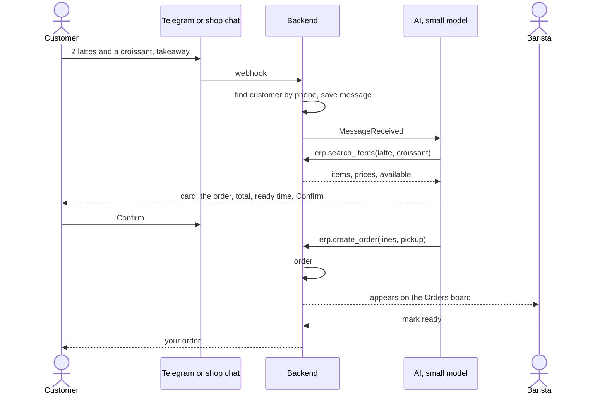

### 18.2 A customer complains

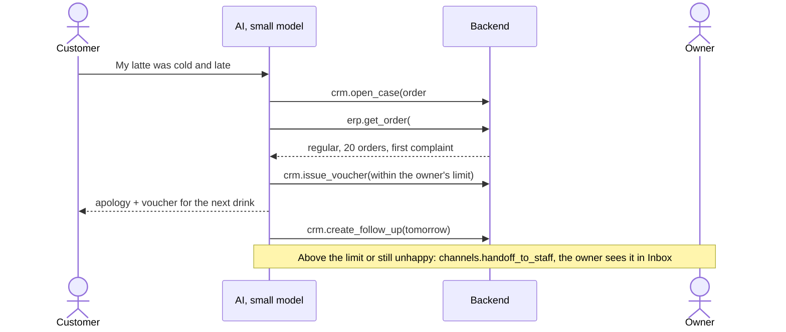

### 18.3 The owner's morning

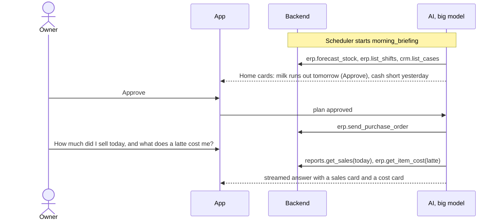

### 18.4 A multi-step task: an offer for slow hours

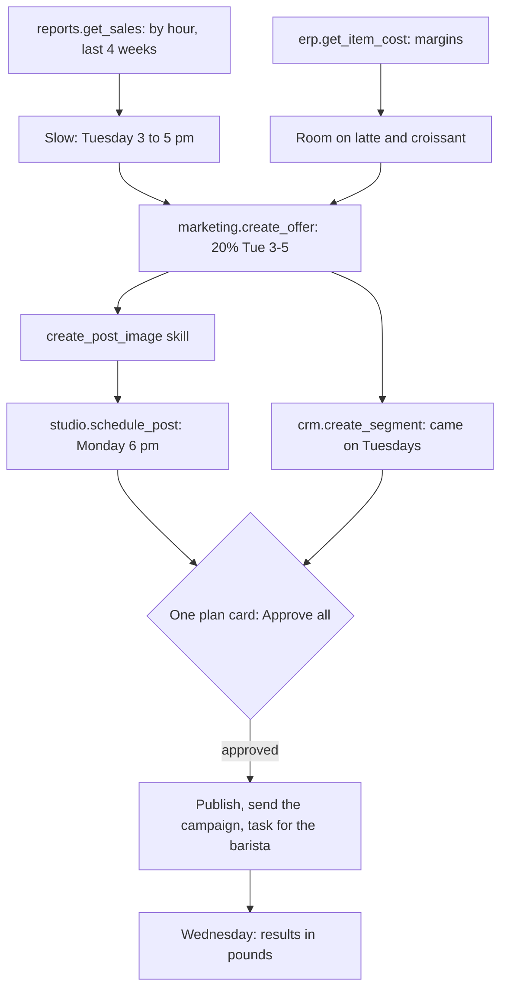

### 18.5 The cashier

The cashier does not go through the AI. They tap items on the sales screen; the
sales screen calls `erp.record_counter_sale`; stock is deducted and
`OrderCompleted` updates reports and the customer's points.

---

## 19. Security

- Login with strong passwords, sessions, and lock-out after repeated failures
- Roles from data, not code; every system call checks them, for the app and the AI alike
- Row-level security on every business table, plus tests that try to cross
  businesses
- Each module's database user sees only its own schema; the AI layer sees none
  of the business schemas
- Audit log on every change, by people and by the AI
- AI safety: tests against prompt injection from customer messages; the AI can
  never do what the person it serves is not allowed to do; skills cannot change
  permissions or approvals
- Public website and chat: limits against spam and fake orders
- Outside API keys (term 2) scoped per business and per system call area
- No secrets in the repository
- **The browser gets only what the screen shows.** No internal IDs (a business
  is named by its handle, a person by `username@handle`), no reason text in
  errors (only the code and the field; the reason goes to the backend's log),
  no rate-limit numbers, no server names or versions. Personal answers are
  never cached. The web app sends the standard safety headers (content
  security policy, no framing, no type sniffing)
- The backend works in the database as a normal role, never as the owner, so
  row-level security always applies to it. The few reads that must cross
  businesses (is this handle free, which businesses am I in) are narrow
  database functions

---

## 20. Where it runs

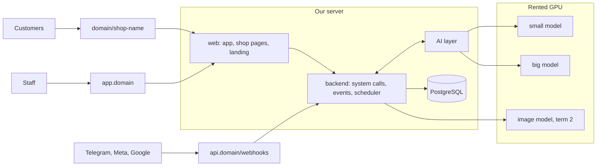

| Part | Where |
|------|-------|
| Staff app | `app.<domain>`, installable on phone and tablet; a mobile app for notifications in term 2 |
| Shop pages | `<domain>/<shop>` for now (the format is open, 26), or the shop's own domain in term 2 |
| Backend, AI layer, database | Our server (to be arranged) |
| Models | Rented GPUs, turned off when not needed |

**Cloud only for now** (agreed 2026-10-20). The app is a website, opened in the
browser on any device. A desktop app comes later, when the team gets there.

**Ports.** The project's parts use local ports **11000 to 11999** and nothing
else; only the front door faces the internet. The front door sends all our
traffic to **our own router on 11000**, and the router owns every path, so we
add or change a path in our own config and deploy it with the rest. Proposed
use (each subteam can change its own):

| Port | Part |
|------|------|
| 11000 | Our router: `/` to the staff app, `/api/` and `/webhooks/` to the backend, the shop pages and landing to their part |
| 11001 | Backend (all four doors) |
| 11002 | AI layer |
| 11003 | Fake backend |
| 11004 | Staff app |
| 11005 | Shop pages and landing |
| 11010 to 11019 | Model servers, when one runs on our server |
| 11432 | PostgreSQL, reachable only from the project's own containers |

---

## 21. Code structure: repos and folders

How the code is laid out. Each folder matches a part of this document, and every
folder in the repos has a page saying what goes in it.

### 21.1 The repos

| Repo | Holds | Who |
|------|-------|-----|
| [`app-backend`](https://github.com/puagraduationproject/app-backend) | Contracts, gateway, kernel, daemons, modules, database, fake backend, tests | Backend |
| [`app-web`](https://github.com/puagraduationproject/app-web) | Staff app, shop pages, landing page | Frontend |
| [`app-ai-agent`](https://github.com/puagraduationproject/app-ai-agent) | The AI layer: faces, jobs, planner, skills | AI agent |
| [`app-ai-model`](https://github.com/puagraduationproject/app-ai-model) | Training, test set, results, serving | AI data |

The contracts live in `app-backend`, because the backend owns them and keeps its
word (4.4). `app-web` and the two AI repos read them from there; none of them
keeps its own copy.

### 21.2 `app-backend`

```
app-backend/
├── README.md                           what it is, how work happens, the other repos
├── rules/                              one page each: parts, architecture, modules, system calls, events, contracts
├── contracts/                          written once, read by every repo (4.4)
│   ├── syscalls/                       per system call: its page and its JSON file (what the
│   │                                   Registry and the AI read), one folder per module
│   │   ├── core/  erp/  crm/  channels/  store/
│   │   ├── studio/  marketing/  team/  reports/  ai/  ogr/
│   │   ├── system/                     the internal system calls Login uses (2.9); never offered
│   │   │                               to the app, the AI or outside callers
│   │   └── (each page: purpose, inputs, output, errors, effects, rules, examples, changes)
│   ├── packs/                          the essentials and one page per pack (7.3): module, needs,
│   │                                   system calls, windows, skills, listeners, settings, setup skill
│   ├── events/                         the envelope (2.6) and one page per event
│   ├── cards/                          order, item, stock, customer, cash, sales, approval, question,
│   │                                   plan, post
│   ├── values/                         IDs, money, order statuses, roles, channels, payment methods,
│   │                                   AI permission settings
│   ├── errors/                         error codes
│   ├── limits/                         password, code expiry, lock-out, upload size, rate limits
│   ├── training/                       training example format (the AI team owns it)
│   └── changes/                        every change to a system call, event or card, announced before merging
├── config/                             settings read once at start; example settings file only
├── templates/                          coffee-shop, small-market: packs on, fields, stages,
│                                       home items, AI defaults, template skills
├── database/
│   ├── migrations/                     one folder per schema, with its tables: core, erp, crm,
│   │                                   channels, store, studio, marketing, team, reports, ai
│   └── seeds/                          invented demo coffee shop and small market
├── gateway/                            mode 1: everything that comes in (2.9)
│   ├── doors/                          one system call API, four doors
│   │   ├── app/                        logged-in members (session); relays owner chat to the AI
│   │   ├── ai/                         the AI (service token plus who it acts for)
│   │   ├── public/                     shop pages, chat widget, channel webhooks; rate limits
│   │   └── outside/                    outside websites with API keys (term 2)
│   ├── login/                          the log-in engine: sign up, log in, codes, passwords, Google,
│   │                                   sessions, lock-out (7.6); asks the Kernel through system.* calls
│   ├── shell/                          the only door into the Kernel: checks each command's
│   │                                   credential and inputs, signs the Pass
│   ├── streaming                       relays the AI's streamed answer to the app
│   ├── realtime                        live updates: orders board, inbox, stock
│   └── server.ts                       starts the program and puts the doors together
├── os/                                 mode 0: the Kernel and the parts around it (2.9)
│   ├── kernel/                         the CPU: processes each call; the only database connection
│   │   ├── call                        takes a system call with its Pass and runs it in one
│   │   │                               transaction: change, audit row, outbox, OGR links
│   │   ├── checks                      may he, same business, data rules, already done, limits
│   │   ├── tenancy                     every call inside one business (row-level security)
│   │   └── context                     business, actor, correlation ID, retry key on every call (2.6)
│   ├── directory/                      businesses, members, roles, locations, templates, packs on,
│   │                                   AI settings; whose is it, what may he do
│   ├── ogr/                            things and their links, per business
│   ├── registry/                       loads every system call's JSON file; filters by pack, role, face
│   ├── system/                         the internal system.* calls for Login: accounts, passwords,
│   │                                   sessions, sending mail
│   ├── drivers/                        the system's own drivers, called only by the Kernel:
│   │                                   mail, files; push, sms (term 2)
│   ├── audit/                          audit row on every write
│   ├── outbox/                         the event, saved in the same transaction as the change
│   ├── approvals/                      saves and checks approvals itself
│   ├── idempotency/                    retried calls write once
│   ├── undo/                           runs a system call's undo from the audit log
│   ├── dry-run/                        runs system calls with no real writes, for skill test runs
│   └── shared/                         small helpers every part uses: numbering (#1042 per
│                                       business), money (whole piastres plus currency),
│                                       errors (codes, never message text)
├── daemons/                            always running; they call the Kernel as "system"
│   ├── events                          delivers the outbox to listeners, retries, listener registry
│   ├── jobs                            every few minutes or at a set time: expiring stock, quiet
│   │                                   regulars, morning briefing, scheduled posts
│   └── retries                         messages and calls an outside service did not accept
├── modules/
│   ├── core/                           notifications, the business profile system calls (7.5)
│   ├── ai/                             the AI module: memory, skills, schedules, the AI action log (6.9)
│   ├── erp/
│   │   ├── catalog/                    items, variants, modifiers, categories (essentials)
│   │   ├── orders/                     orders, lines with snapshots, the order stages
│   │   ├── payments/                   payments, refunds
│   │   ├── sales-screen/               counter sales
│   │   ├── shifts/                     shifts, cash movements, cash gap
│   │   ├── stock/                      movement ledger, levels cache, waste, forecast, rebuild
│   │   ├── recipes/                    ingredients, recipe lines, cost per item
│   │   ├── purchasing/                 suppliers, purchase orders, receiving
│   │   ├── credit/                     customer debts
│   │   ├── expenses/
│   │   └── drivers/                    payments, couriers (term 2)
│   ├── crm/
│   │   ├── customers/                  customers, stats cache, usual order, merge and forget
│   │   ├── identities/                 resolve identity, phone to +20, merge suggestions
│   │   ├── timeline/                   activity from other modules' events
│   │   ├── loyalty/
│   │   ├── support/                    cases, case events, vouchers, follow-ups
│   │   ├── bookings/
│   │   ├── engagement/                 notes, tags
│   │   └── segments/                   segments and consent (term 2)
│   ├── channels/
│   │   ├── inbox/                      incoming queue, duplicates dropped
│   │   ├── conversations/              AI or staff, take over, hand back, tags
│   │   ├── messages/                   one message shape
│   │   ├── auto-replies/               away, opening hours, greeting
│   │   └── drivers/                    website chat, Telegram; WhatsApp, Instagram, Facebook later
│   ├── store/
│   │   ├── site/                       shop page, pages, banner, menu display, public ordering
│   │   ├── search-presence/            descriptions, structured data, score, reviews (term 2)
│   │   └── drivers/                    Google business profile and reviews (term 2)
│   ├── studio/                         brand kit, design templates, render, designs, posts
│   │   └── drivers/                    image model (term 2)
│   ├── marketing/                      offers, campaigns, sends (term 2)
│   ├── team/                           staff profiles, rota, attendance, tasks (term 2)
│   └── reports/                        summary tables from events
│   (each area: system calls as its only public face, service, data, listeners, tests)
├── fake/                               answers every system call from its page's examples and the
│                                       demo businesses, for the frontend and the AI team (6.10)
└── tests/
    ├── isolation                       business A reads business B: must fail
    ├── schema-users                    each module's database user sees only its schema
    ├── roles                           each role against each system call
    ├── syscalls                        each system call: allowed, refused by role, by pack, by face
    ├── pages                           each system call behaves exactly as its reference page says
    ├── packs                           essentials alone, each template, each pack with its needs
    ├── undo                            every write system call's undo puts things back
    ├── order-flow                      every allowed and refused order move
    ├── processes                       each cross-module process (2.7) end to end
    └── rebuild                         stock levels and customer stats rebuilt from history
```

### 21.3 `app-web`

```
app-web/
├── README.md                           windows, layout, roles, rules
├── shared/
│   ├── cards/                          one component per card: used in windows and in AI answers
│   ├── chat/                           message list, streaming, input box, + menu, threads,
│   │                                   plan and approval cards
│   ├── layout/                         sidebar (by role and packs), side panel for opened cards
│   ├── syscalls-client/                   calls the backend's system calls; the only way to the data
│   ├── i18n/                           Arabic and English (Arabic first, right to left)
│   └── tokens/                         colours, spacing, fonts
├── staff/                              windows 1 to 12 (section 17.2)
│   ├── setup/  home/  sales/  orders/  menu-stock/  customers/
│   ├── inbox/  approvals/  settings/                       (term 1)
│   └── team/  marketing/  website-search/                  (term 2)
├── shop/                               windows 13 and 14
│   ├── shop-page/                      the menu and the chat on one page
│   └── order-status/                   stage and ready time, from a link
└── landing/                            window 15
```

### 21.4 `app-ai-agent`

Folders only. The AI team fills them.

```
app-ai-agent/
├── faces/                              customer agent, owner partner
├── jobs/                               scheduled and event-driven work
├── planner/                            plans, approval per plan, running, checking, undo
├── skills/                             core skills
├── system calls/                              system call loading, find_syscalls
├── model/                              talking to the models
├── policy/                             permission settings (6.6), hand-off triggers, injection checks
├── brain/                              profile, knowledge, memory, threads
├── approvals/
├── log/                                AI action log, masking
└── tests/
    ├── fakes/                          fake model and fake system calls built from the system call pages' examples
    ├── conversations/                  scripted conversations with the expected system call calls
    └── injection/                      prompt-injection cases
```

### 21.5 `app-ai-model`

Folders only. The AI team fills them.

```
app-ai-model/
├── configs/  testset/  devset/  data/
├── prepare/  train/  evaluate/  serve/
└── runs/  results/
```

---

## 22. Stack

**Backend and frontend: agreed 2026-10-20**, and can change later if the work
shows a better choice. The AI side is the AI team's choice.

| Part | Stack |
|------|-------|
| Staff app | React, TypeScript, Vite, opened in the browser; Tailwind with shadcn/ui; TanStack Query; i18next; answers streamed with server-sent events |
| Shop pages and landing | Astro |
| Backend | TypeScript on Node 22, Fastify, Kysely, plain SQL migrations per module schema |
| Database | PostgreSQL 16, row-level security, pg-boss for the outbox and jobs |
| Contracts | JSON Schema per system call, event and card; OpenAPI generated from them |
| Security | argon2id passwords, sessions in secure cookies (sessions or tokens is still open, 26), roles checked on every system call call, rate limits, dependency and secret scanning in CI |
| Tests | Vitest, a real PostgreSQL in a container, Playwright for the app |

Each subteam can change its own tools as long as the contracts between parts
hold. Things that shaped the choice:

- The AI side trains and serves open models, which usually means Python for
  training and a model server with the chat-completions-with-tools API
- The planner and the jobs need durable workflows that survive restarts; the AI
  team proposed Temporal
- Row-level security, schemas per module and transactions point to PostgreSQL
- The contracts (system calls, events, cards, the training example format) should use a
  standard format both TypeScript and Python can read
- Any model must be able to call the system calls, so the system call reference must turn
  into the standard tool formats models read, without hand work per model
- The sales screen must work on tablets and phones; answers must stream

---

## 23. What comes in which term

Nothing is dropped. Everything is ordered.

| Area | Term 1 (first presentation) | Term 2 (full product) |
|------|-----------------------------|-----------------------|
| AI | Customer agent, owner partner, morning briefing, alerts, approvals, planner, core skills, owner skill edits (basic) | All jobs, monthly value report, AI-suggested skills, voice and images |
| Models | Both tiers tuned, test set, tuned vs untuned, adaptation test | Larger training data, more categories, image model, model picker with other models, our models compared with commercial ones on the test set |
| Core | Businesses, members, roles, audit, templates (coffee shop, small market), essentials and the library of packs | More templates, outside API keys |
| ERP | Menu, recipes, stock, waste, sales screen, orders, shifts and cash, suppliers and purchases, cost per item, credit basic | Offline sales, credit in full, expiry in full, branches and transfers, payments and couriers, e-invoicing |
| CRM | Customers, identities, timeline, usual order, loyalty, notes, support cases, bookings basic | Segments, consent, merging, bookings in full |
| Channels | Website chat, Telegram; WhatsApp if approved | WhatsApp in full, Instagram, Facebook, posting |
| Store website | Menu, ordering by chat, order status, banner | Theme from Studio, search presence (SEO and GEO), reviews |
| Studio | Brand kit if time allows | Templates, designs, image model, posts |
| Marketing | | Offers, campaigns, win-back |
| Team | | Rota, attendance, tasks, staff performance |
| Reports | Home numbers, sales, profit | Trends, monthly value report |
| App | Windows 1 to 9 and 13 to 15, chat-first | Windows 10 to 12, mobile app, founder tools |

Moving anything new into term 1 (support cases, the planner, skill edits) is
the team's decision; the term 1 plan changes with it.

---

## 24. Research questions

1. Can open models, fine-tuned on Egyptian Arabic small-business work, run a
   business's customer chats and daily operations through system calls and skills, at a
   level owners accept?
2. Does the same model adapt to a new business category with a template, skills
   and little extra data?
3. Does splitting the work into system calls and skills let the model handle new tasks
   without retraining?
4. With the same system calls and skills, how close does our tuned model come to
   commercial models, at what cost per conversation?

**Measured:**

| Measure | How |
|---------|-----|
| Chats handled with no human | Share of conversations in the pilot |
| Right action | Correct system call and inputs on the test set |
| Skill runs | Share of skill runs finished correctly on the test set |
| Orders captured from chat | Share of chat orders created correctly |
| Reply time | Seconds, median and 90th percentile, per tier |
| Owner time and money saved | Pilot, compared with a baseline week before the AI is on |
| Tuned versus untuned | Same test set, tuned against the untuned base model, per tier |
| Tuned versus commercial | Same test set, system calls and skills; our tuned models against commercial models, with cost per conversation |
| Adaptation | Score on a category barely seen in training |
| New skills | Score on skills written after training |

---

## 25. Risks

| Risk | What we do |
|------|-----------|
| Our tuned models are not reliable enough in time | Start data and tuning early; small system call sets per task; skills with exact steps; hand off when unsure; measure weekly |
| The big model costs too much GPU | The AI team confirms its size early; rent by the hour; fall back to a smaller big model |
| Modules drift apart (two records for one customer, shapes that differ) | One owner and one ID per thing (2.4); identity resolution only in CRM (2.5); shared shapes in the contracts; end-to-end tests of every cross-module process |
| The system call list grows messy | One naming rule, one owner per system call, the contracts as the only list; new abilities as skills first |
| An owner's skill edit breaks something | Preview and test run before saving; every version kept; skills cannot change permissions or approvals |
| Meta approval for WhatsApp is slow | Website chat and Telegram first; request approval early |
| Wrong price or order from the AI | Prices and stock only from system calls; confirmation with the customer; hand off below a confidence level |
| Public posts or replies go wrong | Approval for anything public until the owner switches it to act alone |
| Scope creep | Work goes by term; one person has the final say on scope |
| Data leaks between businesses | Row-level security, schema users and tests that try to cross businesses |
| Shops do not adopt it | Built from shop visits; fast sales screen; visible monthly value |
| A picked commercial model leaks business data or costs too much | Our models stay the default; the picker shows what leaves our server and the cost before switching; personal data masked; owner-only switch, audited |
| Skills quietly come to depend on one model | Skills name system calls only (5.6); the test set runs on more than one model |
| Commercial runs leak into our training data | Runs are tagged by model; only runs by our models can become training or test data (6.10) |

---

## 26. Open questions

Decisions still open before the structure is final:

1. **Who checks an approval:** answered 2026-10-21. The Kernel saves and
   checks every approval itself and never trusts an approval ID it is handed (2.9)
2. **Login:** sessions with lock-out, as written here, or tokens? Security decides
3. **The models:** which base models, which sizes, one or two tiers, and the GPU
   cost. The AI team decides
4. **Packs and plans:** whether some packs become paid plans
5. **Images:** whether an open image model is good enough for posts, or posts
   default to a commercial image model the owner picks (4.5)
6. **Other models:** which models the picker offers, who pays for commercial
   ones (the business or a plan), and what the data protection law allows to
   leave the country
7. **Comparison timing:** whether "tuned versus commercial" moves into term 1
   for the first presentation
8. **Where the business brain is stored:** in the backend's AI module (2.9),
   the same for every model, or on the AI team's side. The AI team agrees it
   with the backend
9. **The ai door as an MCP server:** whether the AI reaches the system calls
   through MCP, so any agent that speaks it can use them. The AI team agrees
   it with the backend
10. **The shop page address:** `<shop>.<domain>` (reads best on a QR code,
    needs wildcard DNS and certificates), `<domain>/s/<shop>` (needs nothing
    new), or `<domain>/<shop>` with a long reserved list (today). The first
    two end clashes between handles and our own pages for good
11. **Can a handle change?** Backend's suggestion: not in term 1; later yes,
    with old handles redirecting and never given to another business
12. **Who keeps the brand list and handles reclaim requests:** Security or
    Backend
13. **The kinds of business and the places list:** the Market team confirms
    the kinds from the interviews; whether the 27 governorates and a typed
    area are detailed enough
